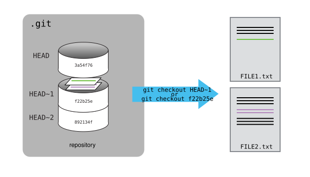
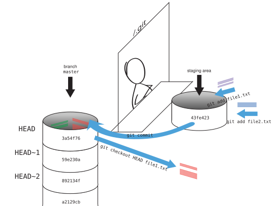

# Exploring History



- Explain what the HEAD of a repository is and how to use it.
- Identify and use Git commit numbers.
- Compare various versions of tracked files.
- Restore old versions of files.
- Undo a commit safely with `git revert`.



As we saw in the previous lesson, we can refer to commits by their
identifiers.  You can refer to the _most recent commit_ of the working
directory by using the identifier `HEAD`.

We've been adding one line at a time to `mars.txt`, so it's easy to track our
progress by looking, so let's do that using our `HEAD`s.  Before we start,
let's make a change to `mars.txt`.

```bash
$ nano mars.txt
$ cat mars.txt
```
```
Cold and dry, but everything is my favorite color
The two moons may be a problem for Wolfman
But the Mummy will appreciate the lack of humidity
An ill-considered change
```

Now, let's see what we get.

```bash
$ git diff HEAD mars.txt
```
```diff
diff --git a/mars.txt b/mars.txt
index b36abfd..0848c8d 100644
--- a/mars.txt
+++ b/mars.txt
@@ -1,3 +1,4 @@
 Cold and dry, but everything is my favorite color
 The two moons may be a problem for Wolfman
 But the Mummy will appreciate the lack of humidity
+An ill-considered change
```

which is the same as what you would get if you leave out `HEAD` (try it).  The
real goodness in all this is when you can refer to previous commits.  We do
that by adding `~1` to refer to the commit one before `HEAD`.

```bash
$ git diff HEAD~1 mars.txt
```

If we want to see the differences between older commits we can use `git diff`
again, but with the notation `HEAD~1`, `HEAD~2`, and so on, to refer to them:


```bash
$ git diff HEAD~2 mars.txt
```
```diff
diff --git a/mars.txt b/mars.txt
index df0654a..b36abfd 100644
--- a/mars.txt
+++ b/mars.txt
@@ -1 +1,3 @@
 Cold and dry, but everything is my favorite color
+The two moons may be a problem for Wolfman
+But the Mummy will appreciate the lack of humidity
```

We could also use `git show` which shows us what changes we made at an older commit as well as the commit message, rather than the _differences_ between a commit and our working directory that we see by using `git diff`.

```bash
$ git show HEAD~2 mars.txt
```
```diff
commit 34961b159c27df3b475cfe4415d94a6d1fcd064d
Author: Vlad Dracula <vlad@tran.sylvan.ia>
Date:   Thu Aug 22 10:07:21 2013 -0400

    Add concerns about effects of Mars' moons on Wolfman

diff --git a/mars.txt b/mars.txt
index df0654a..315bf3a 100644
--- a/mars.txt
+++ b/mars.txt
@@ -1 +1,2 @@
 Cold and dry, but everything is my favorite color
+The two moons may be a problem for Wolfman
```

In this way,
we can build up a chain of commits.
The most recent end of the chain is referred to as `HEAD`;
we can refer to previous commits using the `~` notation,
so `HEAD~1` (pronounced "head minus one")
means "the previous commit",
while `HEAD~123` goes back 123 commits from where we are now.

We can also refer to commits using
those long strings of digits and letters
that `git log` displays.
These are unique IDs for the changes,
and "unique" really does mean unique:
every change to any set of files on any computer
has a unique 40-character identifier.
Our first commit was given the ID
`f22b25e3233b4645dabd0d81e651fe074bd8e73b`,
so let's try this:

```bash
$ git diff f22b25e3233b4645dabd0d81e651fe074bd8e73b mars.txt
```
```diff
diff --git a/mars.txt b/mars.txt
index df0654a..b36abfd 100644
--- a/mars.txt
+++ b/mars.txt
@@ -1 +1,3 @@
 Cold and dry, but everything is my favorite color
+The two moons may be a problem for Wolfman
+But the Mummy will appreciate the lack of humidity
```

That's the right answer,
but typing out random 40-character strings is annoying,
so Git lets us use just the first few characters:

```bash
$ git diff f22b25e mars.txt
```
```diff
diff --git a/mars.txt b/mars.txt
index df0654a..b36abfd 100644
--- a/mars.txt
+++ b/mars.txt
@@ -1 +1,3 @@
 Cold and dry, but everything is my favorite color
+The two moons may be a problem for Wolfman
+But the Mummy will appreciate the lack of humidity
```

All right! So
we can save changes to files and see what we've changed—now how
can we restore older versions of things?
Let's suppose we accidentally overwrite our file:

```bash
$ nano mars.txt
$ cat mars.txt
```
```
We will need to manufacture our own oxygen
```

`git status` now tells us that the file has been changed,
but those changes haven't been staged:

```bash
$ git status
```
```
On branch main
Changes not staged for commit:
  (use "git add <file>..." to update what will be committed)
  (use "git restore <file>..." to discard changes in working directory)
	modified:   mars.txt

no changes added to commit (use "git add" and/or "git commit -a")
```

As the hint suggests, we can put things back the way they were
by using `git restore`:

```bash
$ git restore mars.txt
$ cat mars.txt
```
```
Cold and dry, but everything is my favorite color
The two moons may be a problem for Wolfman
But the Mummy will appreciate the lack of humidity
```

As you might guess from its name,
`git restore` restores a file to an earlier version.
By default it uses the version in the staging area, which (since we have not
staged anything) is the same as the one recorded in `HEAD`, the last commit.
If we want to go back even further,
we can tell it which commit to take the file from with `--source`:

```bash
$ git restore --source=f22b25e mars.txt
$ cat mars.txt
```
```
Cold and dry, but everything is my favorite color
```

```bash
$ git status
```
```
On branch main
Changes not staged for commit:
  (use "git add <file>..." to update what will be committed)
  (use "git restore <file>..." to discard changes in working directory)
	modified:   mars.txt

no changes added to commit (use "git add" and/or "git commit -a")
```

Notice that `git restore` has only changed the file in our working directory:
Git sees it as an ordinary modification, which we could now add and commit if
we wanted to keep the old version.
Instead, let's put things back the way they were:

```bash
$ git restore mars.txt
```



`git restore` brings back old versions of *individual files*. Sometimes you
want to look at the *whole project* as it was at an earlier commit, for example
to check whether an old version of your analysis gave a different result. You
can do this with:

```bash
$ git switch --detach f22b25e
```

Normally, `HEAD` is *attached* to `main`: it follows the latest commit, and
every new commit you make moves `main` forward. `git switch --detach` moves
`HEAD` to an older commit and *detaches* it from `main`, so your files are
exactly as they were at `f22b25e` while `main` itself stays where it was.
(`git switch` needs the `--detach` flag to confirm that this is really what
you want; without it, it only switches between branches, which we will meet
in the lesson on [branching and merging](07-branches.md).)

Git will tell you that you are now in a "detached HEAD" state. This is a
perfectly safe way to look around and run things, but don't make new commits
here: they would not belong to `main`, and are easy to lose once you switch
away. When you are done, go back to the latest version with:

```bash
$ git switch main
```



It's important to remember that
we must use the commit number that identifies the state of the repository
*before* the change we're trying to undo.
A common mistake is to use the number of
the commit in which we made the change we're trying to get rid of.
In the example below, we want to retrieve the state from before the most
recent commit (`HEAD~1`), which is commit `f22b25e`:



So, to put it all together,
here's how Git works in cartoon form:





`git restore` and `git switch` were added in Git 2.23 (2019). Before that,
a single command, `git checkout`, did both jobs, and you will still see it in
many tutorials, scripts and Stack Overflow answers. It still works:

| Older command | Modern equivalent |
|:--------------|:------------------|
| `git checkout -- mars.txt` | `git restore mars.txt` |
| `git checkout f22b25e mars.txt` | `git restore --source=f22b25e --staged --worktree mars.txt` |
| `git checkout main` | `git switch main` |
| `git checkout f22b25e` | `git switch --detach f22b25e` |

Note two differences. First, `git checkout <commit> <file>` also puts the old
version in the staging area, while `git restore --source=<commit> <file>`
only changes your working directory unless you ask for more. Second, older
versions of `git status` suggested `git checkout -- <file>`: the double dash
`--` separates the names of files from the rest of the command, so that Git
does not mistake a file name for a commit or branch name.



The fact that files can be restored one by one
tends to change the way people organize their work.
If everything is in one large document,
it's hard (but not impossible) to undo changes to the introduction
without also undoing changes made later to the conclusion.
If the introduction and conclusion are stored in separate files,
on the other hand,
moving backward and forward in time becomes much easier.

`git restore` only changes files in your working directory and staging area.
If a mistake has already been *committed*, and especially if that commit has
already been shared with others, use `git revert` instead: it makes a *new*
commit that undoes the changes of an earlier one, so the history stays intact
and your collaborators receive the fix like any other change:

```bash
$ git revert HEAD
```

Git opens your editor with a suggested commit message (`Revert "..."`); save
and close it to create the new commit.

To summarise the ways of going back that we have seen:

| I want to... | Command |
|:-------------|:--------|
| discard changes to a file that I haven't staged | `git restore <file>` |
| unstage a file, but keep my changes | `git restore --staged <file>` |
| get a file back as it was in an older commit | `git restore --source=<commit> <file>` |
| undo a commit, keeping the history | `git revert <commit>` |
| look at the whole project at an older commit | `git switch --detach <commit>`, then `git switch main` |



`git revert` is the safe way to undo a commit, because it only ever *adds* to
the history. Git can also *rewrite* history with `git reset`, which moves your
branch back to an earlier commit as if the later ones had never happened:

```bash
$ git reset --soft HEAD~1   # undo the last commit, but keep its changes staged
$ git reset --hard HEAD~1   # undo the last commit AND throw away its changes
```

Only rewrite commits that you have **not yet pushed**: if others already have
them, rewriting history will cause them (and you) a lot of confusion.
`git reset --hard` also permanently discards any uncommitted changes, so use it
with care!

If you do get into a mess, `git reflog` is your safety net. It lists every
commit that `HEAD` has pointed to recently, including ones that no longer
appear in `git log`, so you can get back to them:

```bash
$ git reflog
$ git reset --hard <commit from the reflog>
```






Jennifer has made changes to the Python script that she has been working on for weeks, and the
modifications she made this morning "broke" the script and it no longer runs. She has spent
~ 1hr trying to fix it, with no luck...

Luckily, she has been keeping track of her project's versions using Git! Which commands below will
let her recover the last committed version of her Python script called
`data_cruncher.py`?

1. `$ git restore HEAD`

2. `$ git restore data_cruncher.py`

3. `$ git restore --source=HEAD~1 data_cruncher.py`

4. `$ git restore --source=<unique ID of last commit> data_cruncher.py`

5. Both 2 and 4



The answer is (5): both 2 and 4.

1. `git restore` expects file names, so Git complains that there is no file
   called `HEAD`: `error: pathspec 'HEAD' did not match any file(s) known to git`.
2. `git restore data_cruncher.py` replaces the file with the version in the
   staging area. As long as Jennifer has not staged her broken changes with
   `git add`, this is the same as the last committed version.
3. `--source=HEAD~1` recovers the version from the commit *before* the last
   one, so she would lose the work she committed most recently.
4. Using the ID of the last commit as `--source` gives exactly the last
   committed version.

If Jennifer *had* already staged her broken changes, option 2 would not help;
`git restore --source=HEAD --staged --worktree data_cruncher.py` would restore
both the staging area and the file from the last commit.








Jennifer is collaborating on her Python script with her colleagues and
realizes her last commit to the group repository is wrong and wants to
undo it.  Jennifer needs to undo correctly so everyone in the group
repository gets the correct change.  `git revert [wrong commit ID]`
will make a new commit that undoes Jennifer's previous wrong
commit. Therefore `git revert` is different from `git restore`, which only
changes files in your own working directory and does not record anything in
the shared history.  Below are the right steps and explanations for
Jennifer to use `git revert`, what is the missing command?

1. ________ # Look at the git history of the project to find the commit ID

2. Copy the ID (the first few characters of the ID, e.g. 0b1d055).

3. `git revert [commit ID]`

4. Type in the new commit message.

5. Save and close



The missing command is `git log`, which lists the commits with their
identifiers. `git log --oneline` makes the list shorter and the identifiers
easier to copy.








What is the output of cat venus.txt at the end of this set of commands?

```bash
$ cd planets
$ nano venus.txt #input the following text: Venus is beautiful and full of love
$ git add venus.txt
$ nano venus.txt #add the following text: Venus is too hot to be suitable as a base
$ git commit -m "Comment on Venus as an unsuitable base"
$ git restore venus.txt
$ cat venus.txt #this will print the contents of venus.txt to the screen
```

1.

```
Venus is too hot to be suitable as a base
```

2.

```
Venus is beautiful and full of love
```

3.

```
Venus is beautiful and full of love
Venus is too hot to be suitable as a base
```

4.

```
Error because you have changed venus.txt without committing the changes
```




Line by line:
```bash
$ cd planets
```
Enters into the 'planets' directory

```bash
$ nano venus.txt #input the following text: Venus is beautiful and full of love
```
We created a new file and wrote a sentence in it, but the file is not tracked by git.

```bash
$ git add venus.txt
```
Now the file is staged. The changes that have been made to the file until now will be committed in the next commit.

```bash
$ nano venus.txt #add the following text: Venus is too hot to be suitable as a base
```
The file has been modified. The new changes are not staged because we have not added the file.

```bash
$ git commit -m "Comment on Venus as an unsuitable base"
```
The changes that were staged (Venus is beautiful and full of love) have been committed. The changes that were not staged (Venus is too hot to be suitable as a base) have not. Our local working copy is different than the copy in our local repository.

```bash
$ git restore venus.txt
```
With `git restore` we discard the changes in the working directory, so that our local copy is exactly the same as the version in the staging area, which after the commit is also the version in `HEAD`, the most recent commit.

```bash
$ cat venus.txt #this will print the contents of venus.txt to the screen
```
If we print venus.txt we will get answer 2.








Consider this command: `git diff HEAD~3 mars.txt`. What do you predict this command
will do if you execute it? What happens when you do execute it? Why?

Try another command, `git diff [ID] mars.txt`, where [ID] is replaced with
the unique identifier for your most recent commit. What do you think will happen,
and what does happen?



`git diff HEAD~3 mars.txt` shows the changes to `mars.txt` between the commit
three before `HEAD` and the current state of the file. If the repository has
fewer than four commits, there is no such commit and Git stops with an error:

```
fatal: ambiguous argument 'HEAD~3': unknown revision or path not in the working tree.
```

`git diff [ID] mars.txt` with the ID of the most recent commit compares that
commit with the current state of the file, which is the same as
`git diff HEAD mars.txt`. If you have not changed `mars.txt` since your last
commit, it prints nothing at all.








`git restore` can be used to discard changes that have not been staged, but
will it also work for changes that have been staged but not committed?
Make a change to `mars.txt`, add that change, and use `git restore mars.txt` to see if
you can remove your change. If not, read the hints printed by `git status`
to find out how to get rid of it.



`git restore mars.txt` appears to do nothing: it restores the file from the
staging area, and the staging area already contains our change. `git status`
suggests the way out:

```
Changes to be committed:
  (use "git restore --staged <file>..." to unstage)
	modified:   mars.txt
```

`git restore --staged mars.txt` removes the change from the staging area but
keeps it in the file, and a second `git restore mars.txt` then discards it from
the file too. Both steps can be done at once with:

```bash
$ git restore --staged --worktree mars.txt
```








Exploring history is an important part of git, often it is a challenge to find
the right commit ID, especially if the commit is from several months ago.

Imagine the `planets` project has more than 50 files.
You would like to find the commit in which some specific text in `mars.txt`
was modified. When you type `git log`, a very long list appears.
How can you narrow down the search?

Remember that the `git diff` command allows us to explore one specific file,
e.g. `git diff mars.txt`. We can apply a similar idea here.

```bash
$ git log mars.txt
```

Unfortunately some of these commit messages are very ambiguous e.g. `update files`.
How can you search through these files?

Both `git diff` and `git log` are very useful and they summarize different part of the history for you.
Is that possible to combine both? Let's try the following:

```bash
$ git log --patch mars.txt
```

You should get a long list of output, and you should be able to see both commit messages and the difference between each commit.

Question: What does the following command do?

```bash
$ git log --patch HEAD~3 *.txt
```



It shows the history starting from `HEAD~3` (three commits before the most
recent one) and going back in time, including only commits that changed one of
the `.txt` files, together with the changes each of them made. Note that the
shell expands `*.txt` into the names of the `.txt` files in the current
directory before Git sees the command.








- `git diff` displays differences between commits.
- `git restore` recovers old versions of files; `git restore --staged` unstages them.
- `git revert` undoes a commit by making a new commit, so the history stays intact.
- `git switch --detach` lets you look at the whole project at an earlier commit.



 [CC BY 4.0](https://creativecommons.org/licenses/by/4.0/legalcode) - Based on [git-novice](https://github.com/swcarpentry/git-novice) © 2016–2017 Software Carpentry Foundation 

