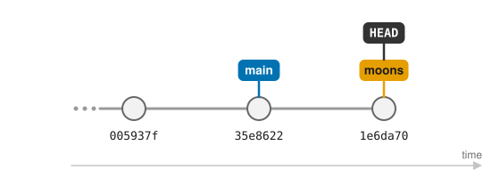
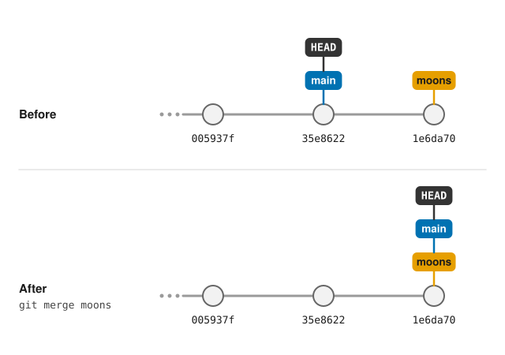
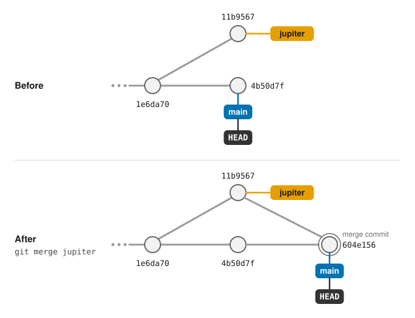

# Branching and Merging



- Explain what a branch is and why branches are useful.
- Create, list and switch between branches.
- Merge a branch back into `main`.
- Tell the difference between a fast-forward merge and a merge commit.
- Mark important versions with tags.



So far, all of Dracula's commits have gone one after the other into a single
line of history. That works well while there is only one thing going on at a
time, but real work is rarely like that. Dracula might want to try out an idea
without disturbing notes that he knows are correct, or to work on two
unrelated topics at once and only keep the one that works out.

Git's answer to this is **branches**. A branch is an independent line of
development: you can make commits on it without affecting any other branch,
switch back and forth between branches at any time, and later *merge* the
work from one branch into another.

We have actually been using a branch all along. Every `git status` has started
with `On branch main`: `main` is simply the branch Git created for us when we
ran `git init`.

## Listing and creating branches

`git branch` lists the branches in our repository:

```bash
$ git branch
```
```
* main
```

The `*` marks the branch we are currently on. Dracula wants to write some notes
about the two moons of Mars, but isn't sure yet whether they are worth keeping,
so he starts a new branch called `moons` for them:

```bash
$ git switch -c moons
```
```
Switched to a new branch 'moons'
```

`git switch` moves us to another branch, and the `-c` option (for *create*)
creates that branch first. The new branch starts from the commit we were on,
so for now `moons` and `main` contain exactly the same work:

```bash
$ git branch
```
```
  main
* moons
```

## Working on a branch

Commits work exactly as before. Let's create a new file and commit it:

```bash
$ nano moons.txt
$ cat moons.txt
```
```
Phobos and Deimos are too small to live on, but could be useful for mining
```

```bash
$ git add moons.txt
$ git commit -m "Add notes on the moons of Mars"
```
```
[moons 1e6da70] Add notes on the moons of Mars
 1 file changed, 1 insertion(+)
 create mode 100644 moons.txt
```

Notice that Git now tells us which branch the commit was made on. The
`--graph` and `--all` options of `git log` show us all branches at once:

```bash
$ git log --oneline --graph --all
```
```
* 1e6da70 (HEAD -> moons) Add notes on the moons of Mars
* 35e8622 (main) Add the ignore file
* 005937f Discuss concerns about Mars' climate for Mummy
* 34961b1 Add concerns about effects of Mars' moons on Wolfman
* f22b25e Start notes on Mars as a base
```

(Your commit identifiers will be different, and your history may contain some
extra commits from the exercises.)

The labels in brackets show where each branch currently points: `moons` is one
commit ahead of `main`, and `HEAD -> moons` tells us that `moons` is the branch
we are on. This is really all a branch is: a *label* pointing at a commit,
which moves forward every time we commit on that branch.



Now let's go back to `main`:

```bash
$ git switch main
$ ls
```
```
Switched to branch 'main'
mars.txt
```

`moons.txt` has disappeared! It hasn't been lost: it only exists on the `moons`
branch, and when we switch branches Git updates the files in our working
directory to match the branch we switch to. If we ran `git switch moons` again,
it would come back.



Before switching branches, commit (or discard) any changes you are working on.
Git will refuse to switch if that would overwrite changes you haven't
committed, and uncommitted changes that don't clash with anything are carried
over to the other branch, which can be confusing. Running `git status` before
`git switch` is a good habit.





Sometimes you are halfway through a change when you need to switch branch, and
the work isn't ready to be committed yet. If the other branch has its own
version of a file you have changed, switching would overwrite your changes, so
Git refuses:

```bash
$ git switch experiment
```
```
error: Your local changes to the following files would be overwritten by checkout:
	mars.txt
Please commit your changes or stash them before you switch branches.
Aborting
```

As the message suggests, `git stash` puts your uncommitted changes aside, leaving
you with a clean working directory:

```bash
$ git stash
```
```
Saved working directory and index state WIP on main: 35e8622 Add the ignore file
```

```bash
$ git status
```
```
On branch main
nothing to commit, working tree clean
```

You can now switch to the other branch, do what you need to do there, and come
back. `git stash list` shows what you have put aside, and `git stash pop` brings
the most recent changes back (and removes them from the stash):

```bash
$ git switch main
$ git stash pop
```
```
On branch main
Changes not staged for commit:
  (use "git add <file>..." to update what will be committed)
  (use "git restore <file>..." to discard changes in working directory)
	modified:   mars.txt

no changes added to commit (use "git add" and/or "git commit -a")
Dropped refs/stash@{0} (eda7444b23f062e7df3b9509cd4e67e29e52ff4a)
```

The stash is meant for short interruptions: it is easy to forget what you have
put there, so for anything longer, commit your work on a branch instead.



## Merging a branch

Dracula is happy with his notes on the moons, so he wants to bring them into
`main`. From the branch that should *receive* the work (here, `main`), we run
`git merge` with the name of the branch to merge in:

```bash
$ git merge moons
```
```
Updating 35e8622..1e6da70
Fast-forward
 moons.txt | 1 +
 1 file changed, 1 insertion(+)
 create mode 100644 moons.txt
```

```bash
$ git log --oneline --graph --all
```
```
* 1e6da70 (HEAD -> main, moons) Add notes on the moons of Mars
* 35e8622 Add the ignore file
* 005937f Discuss concerns about Mars' climate for Mummy
* 34961b1 Add concerns about effects of Mars' moons on Wolfman
* f22b25e Start notes on Mars as a base
```

Git calls this a **fast-forward** merge: nothing had happened on `main` since
`moons` was created, so all Git had to do was move the `main` label forward to
the same commit as `moons`. No new commit was needed.



The animation below replays the whole story so far: creating the branch,
committing on it, switching back to `main` and merging with a fast-forward.
Watch how the commits stay where they are, while the `main` and `moons` labels,
and `HEAD`, move between them:


The `moons` branch has done its job, so we can delete it. This only removes the
label; the commits are safely part of `main` now:

```bash
$ git branch -d moons
```
```
Deleted branch moons (was 1e6da70).
```

## When both branches have moved on

Fast-forwards are the simple case. More often, work continues on `main` while
a branch is being worked on. Let's start a new branch for some notes on Jupiter:

```bash
$ git switch -c jupiter
$ nano jupiter.txt
$ cat jupiter.txt
```
```
Too much radiation, but Europa might be worth a visit
```

```bash
$ git add jupiter.txt
$ git commit -m "Start notes on Jupiter"
```

Meanwhile, Dracula goes back to `main` and adds a line to `mars.txt`:

```bash
$ git switch main
$ nano mars.txt
$ cat mars.txt
```
```
Cold and dry, but everything is my favorite color
The two moons may be a problem for Wolfman
But the Mummy will appreciate the lack of humidity
Dust storms can last for months
```

```bash
$ git add mars.txt
$ git commit -m "Warn about dust storms on Mars"
```

Now the history has split in two: each branch has a commit that the other does
not have.

```bash
$ git log --oneline --graph --all
```
```
* 4b50d7f (HEAD -> main) Warn about dust storms on Mars
| * 11b9567 (jupiter) Start notes on Jupiter
|/
* 1e6da70 Add notes on the moons of Mars
* 35e8622 Add the ignore file
...
```

A fast-forward is no longer possible, because `main` can't simply be moved to
where `jupiter` is without losing the dust storm commit. When we merge, Git
combines the two lines of work by creating a new **merge commit** with two
parents:

```bash
$ git merge jupiter
```

Git opens our editor with a suggested message, `Merge branch 'jupiter'`, which
we can just save and close. Git then reports:

```
Merge made by the 'ort' strategy.
 jupiter.txt | 1 +
 1 file changed, 1 insertion(+)
 create mode 100644 jupiter.txt
```

```bash
$ git log --oneline --graph --all
```
```
*   604e156 (HEAD -> main) Merge branch 'jupiter'
|\
| * 11b9567 (jupiter) Start notes on Jupiter
* | 4b50d7f Warn about dust storms on Mars
|/
* 1e6da70 Add notes on the moons of Mars
* 35e8622 Add the ignore file
...
```



The graph shows the two lines of work coming back together. `main` now contains
both the dust storm warning and `jupiter.txt`, so we can delete the branch:

```bash
$ git branch -d jupiter
```
```
Deleted branch jupiter (was 11b9567).
```

## Tags: labels that stay put

A branch is a label that moves forward with every new commit. Sometimes we want
the opposite: a label that marks one particular commit forever, such as the
version of the code used for a paper, or version `1.0` of a tool. Git calls
these **tags**.

Dracula's notes have reached a state he is happy with, so he tags it:

```bash
$ git tag -a v1.0 -m "First complete set of planet notes"
```

The `-a` option creates an *annotated* tag, which records who made it, when,
and a message (given with `-m`), much like a commit. `git tag` lists the tags,
and `git log` shows them next to the commit they point to:

```bash
$ git tag
```
```
v1.0
```

```bash
$ git log --oneline -1
```
```
604e156 (HEAD -> main, tag: v1.0) Merge branch 'jupiter'
```

From now on, `v1.0` can be used anywhere a commit identifier is expected, for
example `git diff v1.0 mars.txt` or `git switch --detach v1.0`, and it will
always mean this commit, however many commits are added later.



Tags are not sent to a remote repository by `git push` unless you ask for them,
with `git push origin v1.0` for one tag, or `git push origin --tags` for all
of them. Hosting platforms such as GitLab and GitHub then list your tags, and
let you turn a tag into a *release* with a description and downloadable files.
Releases are also what services like Zenodo archive to give your software a
citable DOI, as we will see in the lesson on [citation](16-citation.md).





Here Git could combine the two branches automatically, because they changed
different files. If both branches change the *same lines* of the same file, Git
can't know which version is right, and asks us to decide. This is called a
*conflict*, and we will learn how to resolve one in the lesson on
[conflicts](12-conflict.md).





A few habits that make branches easy to live with:

* Keep `main` in a working state, and do each new piece of work (a feature, a
  fix, an experiment) on its own branch.
* Give branches short, descriptive names, such as `add-moon-notes` or
  `fix-mars-typo`.
* Merge branches back when the work is done, and delete them afterwards.

This is also how most collaboration works on platforms such as GitLab and
GitHub: each contribution is developed on its own branch and then proposed for
merging, as we will see in the lesson on
[pull requests](11-pullrequests.md).





In [Exploring History](05-history.md) we used `git switch --detach` to look at
an old commit. Now we can see what "detached" means: normally `HEAD` points to
a *branch* (as in `HEAD -> main`), and the branch moves forward with each new
commit. In detached HEAD state, `HEAD` points directly at a commit and no
branch follows along, so any commits you make there don't belong to any branch.

If you do make commits while detached and want to keep them, create a branch
for them before switching away:

```bash
$ git switch -c my-experiment
```





Before `git switch` was added in Git 2.23 (2019), branches were created and
changed with `git checkout`, which still works:

```eval_rst
.. list-table::
   :header-rows: 1

   * - Older command
     - Modern equivalent
   * - ``git checkout moons``
     - ``git switch moons``
   * - ``git checkout -b moons``
     - ``git switch -c moons``
```





Dracula runs `git branch` and sees:

```
  jupiter
* main
  saturn
```

Which branch is he on? How can he start working on `saturn`? How could he
check that the switch worked?



He is on `main`, marked with `*`. He can move to `saturn` with
`git switch saturn`; afterwards `git branch` shows `*` next to `saturn`, and
`git status` starts with `On branch saturn`.







In each case, Dracula runs `git merge feature` while on `main`. Will Git do a
fast-forward, or create a merge commit?

1. He created `feature`, made two commits on it, and made no commits on `main`
   in the meantime.
2. He created `feature`, made one commit on it, then switched back to `main`
   and made one commit there.



1. A fast-forward: `main` has not moved since `feature` was created, so Git
   only needs to move the `main` label forward.
2. A merge commit: both branches have commits the other does not have, so Git
   has to combine them with a new commit that has two parents.







In your `planets` repository:

1. Create a branch called `saturn` and switch to it.
2. Create a file `saturn.txt` with a note about Saturn, and commit it.
3. Switch back to `main` and check that `saturn.txt` is not there.
4. Merge `saturn` into `main`, check the history with
   `git log --oneline --graph --all`, and delete the branch.



```bash
$ git switch -c saturn
$ nano saturn.txt
$ git add saturn.txt
$ git commit -m "Add notes on Saturn"
$ git switch main
$ ls                    # saturn.txt is not listed
$ git merge saturn      # a fast-forward, since main has not changed
$ git log --oneline --graph --all
$ git branch -d saturn
```







Create a branch, make a commit on it, switch back to `main` and, *without*
merging, try to delete it with `git branch -d`. What happens, and why?



Git refuses:

```
error: the branch 'saturn' is not fully merged.
If you are sure you want to delete it, run 'git branch -D saturn'
```

The commits on that branch are not part of any other branch, so deleting the
label would make them very hard to find again. Git protects us from losing work
by accident. If we really want to throw the work away, `git branch -D` (with a
capital `D`) forces the deletion.







- A branch is an independent line of development; `main` is the branch Git creates by default.
- `git branch` lists branches, and `git switch -c <name>` creates a new branch and switches to it.
- `git switch <name>` changes branch, updating the files in the working directory to match.
- `git merge <name>` brings the work from another branch into the current one.
- If the current branch has not moved on, the merge is a fast-forward; otherwise Git creates a merge commit.
- `git branch -d <name>` deletes a branch once it has been merged.
- `git stash` puts uncommitted changes aside, and `git stash pop` brings them back.
- A tag (`git tag -a v1.0 -m "..."`) is a label that permanently marks one commit, such as a released version.



[CC BY 4.0](https://creativecommons.org/licenses/by/4.0/legalcode) - Original content
