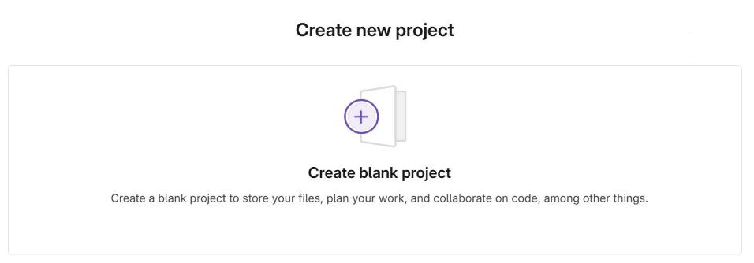
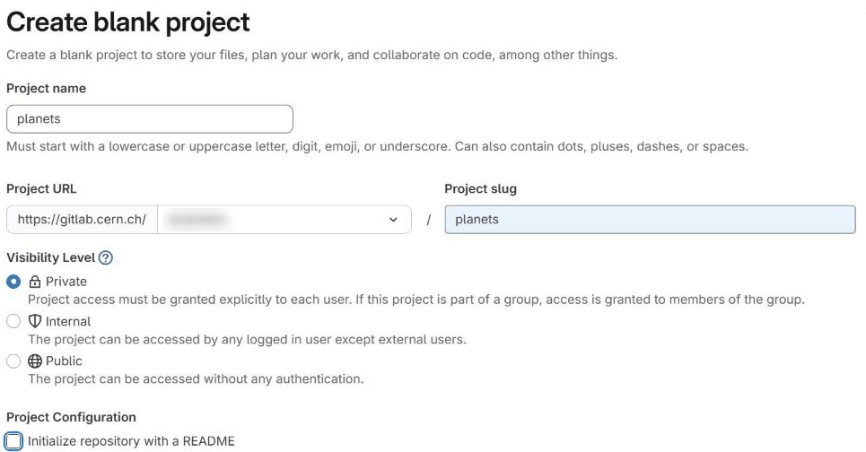
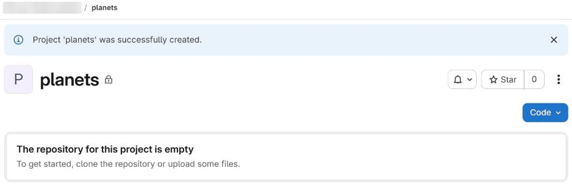
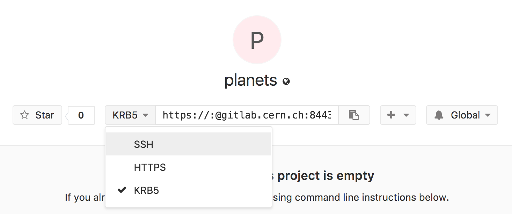
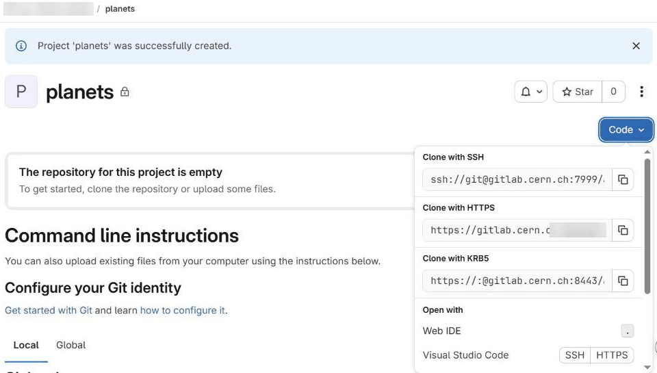
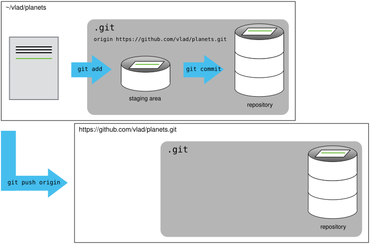

# Remotes in CERN GitLab



- Explain what remote repositories are and why they are useful.
- Push to or pull from a remote repository.





- An SSH key added to your CERN GitLab account, see [here](https://docs.gitlab.com/user/ssh/)
  for instructions.
- You can test if this is working by runnning `ssh git@gitlab.cern.ch -T -p 7999`.
  Everything is working correctly if the output of the command is:

```
Welcome to GitLab, Santa Claus!
```



Version control really comes into its own when we begin to collaborate with
other people.  We already have most of the machinery we need to do this; the
only thing missing is to copy changes from one repository to another.

Systems like Git allow us to move work between any two repositories.  In
practice, though, it's easiest to use one copy as a central hub, and to keep it
on the web rather than on someone's laptop.  Most programmers use hosting
services like [GitHub](https://github.com), [BitBucket](https://bitbucket.org) or
[GitLab](https://gitlab.com/) to hold those central copies. All of these services
are the same from the perspective of the git command line however each
provider's website offers slightly different features. In this lesson we will
use [CERN's instance of GitLab](https://gitlab.cern.ch/). This is the similar to
the public GitLab instance except it is hosted by CERN and is integrated with
various CERN services such as [Single Sign On](https://information-technology.web.cern.ch/services/SSO-Service)
and [JIRA](https://information-technology.web.cern.ch/services/JIRA-service).

Let's start by sharing the changes we've made to our current project with the
world.  Log in to [CERN GitLab](https://gitlab.cern.ch/), then use the **New
project** button (or the **+** menu) and choose to create a *blank project*:



Name your repository "planets" and then click "Create project":





Make sure the option **Initialize repository with a README** is *not* ticked.
We already have a repository with some history on our own computer, so we want
the one on GitLab to be completely empty. If GitLab creates a README file for
us, the remote will contain a commit that our local repository does not have,
and our first push will be rejected.



Note the *visibility level* of the project. Every CERN user can create a
*private* repository, meaning its access can be restricted to the people you
choose; you can also make it visible to all CERN users, or public to the whole
world. Private repositories are very useful when collaborating on a paper or an
analysis that is not yet public. (External services such as
[GitHub](https://github.com) also offer free private repositories nowadays; a
key advantage of CERN GitLab is its integration with CERN accounts and
services.)

As soon as the repository is created, GitLab displays a page with a URL and some
information on how to configure your local repository:



This is roughly equivalent to perform the following on CERN's servers:

```bash
$ mkdir planets
$ cd planets
$ git init --bare
```

Our local repository still contains our earlier work on `mars.txt`, but the
remote repository on CERN GitLab doesn't contain any files yet:



The next step is to connect the two repositories.  We do this by making the
GitLab repository a remote for the local repository.
The home page of the repository on GitLab includes the string we need to
identify it:



Click on the 'SSH' link to change the protocol from
KRB5 to SSH and then copy that URL from the browser, go into the local `planets`
repository, and run this command:

```bash
$ git remote add origin ssh://git@gitlab.cern.ch:7999/vlad/planets.git
```

Make sure to use the URL for your repository rather than Vlad's: the only
difference should be your username instead of `vlad`.

We can check that the command has worked by running `git remote -v`:

```bash
$ git remote -v
```
```
origin  ssh://git@gitlab.cern.ch:7999/vlad/planets.git (fetch)
origin  ssh://git@gitlab.cern.ch:7999/vlad/planets.git (push)
```

The name `origin` is a local nickname for your remote repository. We could use
something else if we wanted to, but `origin` is by far the most common choice.

Once the nickname `origin` is set up, this command will push the changes from
our local `main` branch to the repository on GitLab:

```bash
$ git push -u origin main
```
```
Enumerating objects: 9, done.
Counting objects: 100% (9/9), done.
Delta compression using up to 4 threads
Compressing objects: 100% (6/6), done.
Writing objects: 100% (9/9), 821 bytes | 821.00 KiB/s, done.
Total 9 (delta 2), reused 0 (delta 0), pack-reused 0
To ssh://gitlab.cern.ch:7999/vlad/planets.git
 * [new branch]      main -> main
branch 'main' set up to track 'origin/main'.
```

Our local and remote repositories are now in this state:





`-u` (short for `--set-upstream`) links our local `main` branch to the `main`
branch on `origin`, so that Git remembers where this branch is pushed to and
pulled from. The last line of the output confirms it:
`branch 'main' set up to track 'origin/main'`.

We only need `-u` the **first time** we push a branch. After that:

* `git push` and `git pull` work without any arguments, because Git already
  knows which remote and branch to use;
* `git status` tells us how our branch compares with the one on GitLab, for
  example `Your branch is ahead of 'origin/main' by 1 commit`, which is a
  reminder that we have commits we haven't pushed yet.

In the rest of this lesson we sometimes still write `git push origin main` in
full. This does exactly the same as `git push`, it just spells out where the
changes are going.



We can pull changes from the remote repository to the local one as well:

```bash
$ git pull origin main
```
```
From ssh://gitlab.cern.ch:7999/vlad/planets
 * branch            main       -> FETCH_HEAD
Already up to date.
```

Pulling has no effect in this case because the two repositories are already
synchronized.  If someone else had pushed some changes to the repository on
GitLab, though, this command would download them to our local repository.




Browse to your `planets` repository on GitLab.
Under the "Repository" tab, find and click on the text that says "Commits".

Hover over, and click on, the three buttons to the right of each commit.
What information can you gather/explore from these buttons?
How would you get that same information in the shell?



The button with the picture of a clipboard copies the full
identifier of the commit to the clipboard. In the shell, ```git log``` will show
you the full commit identifier for each commit.

When you click on the commit message, you'll see all of the changes that were
made in that particular commit. Green shaded lines indicate additions and red
ones removals. In the shell we can do the same thing with ```git diff```. In
particular, ```git diff ID1..ID2``` where ID1 and ID2 are commit identifiers
(e.g. ```git diff a3bf1e5..041e637```) will show the differences between those
two commits.

The right-most button ("Browse files") lets you view all of the files in the repository at the
time of that commit. To do this in the shell, we can switch the whole
repository to that point in time with `git switch --detach ID`,
where ID is the identifier of the commit we want to look at (see the
"detached HEAD" panel in [Exploring History](05-history.md) for what this
does). If we do this, we need to remember to go back to the latest version
afterwards with `git switch main`!








Create a remote repository on GitLab.  Push the contents of your local
repository to the remote.  Make changes to your local repository and push
these changes.  Go to the repo you just created on GitLab and check the
timestamps of the files.  How does
GitLab record times, and why?



GitLab displays timestamps in a human readable relative format (i.e.
"22 hours ago" or "three weeks ago"). However, if you hover over the timestamp,
you can see the exact time at which the last change to the file occurred.








In this lesson, we introduced the "git push" command.
How is "git push" different from "git commit"?



When we push changes, we're interacting with a remote repository to update it
with the changes we've made locally (often this corresponds to sharing the
changes we've made with others). Commit only updates your local repository.








It happens quite often in practice that you made a typo in the
remote URL. This exercise is about how to fix this kind of issues.
First start by adding a remote with an invalid URL:

```
git remote add broken https://gitlab.cern.ch/this/url/is/invalid
```

Do you get an error when adding the remote? Can you think of a
command that would make it obvious that your remote URL was not
valid? Can you figure out how to fix the URL (tip: use `git remote
-h`)? Don't forget to clean up and remove this remote once you are
done with this exercise.



We don't see any error message when we add the remote (adding the remote tells
git about it, but doesn't try to use it yet). As soon as we try to use
```git push``` we'll see an error message. The command ```git remote set-url```
allows us to change the remote's URL to fix it.







- A local Git repository can be connected to one or more remote repositories.
- Use the SSH protocol to connect to remote repositories.
- `git push` copies changes from a local repository to a remote repository.
- `git pull` copies changes from a remote repository to a local repository.



 [CC BY 4.0](https://creativecommons.org/licenses/by/4.0/legalcode) - Based on [git-novice](https://github.com/swcarpentry/git-novice) © 2016–2017 Software Carpentry Foundation 

