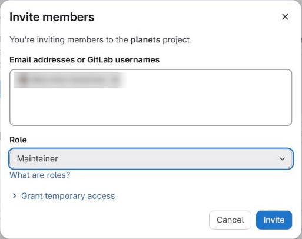
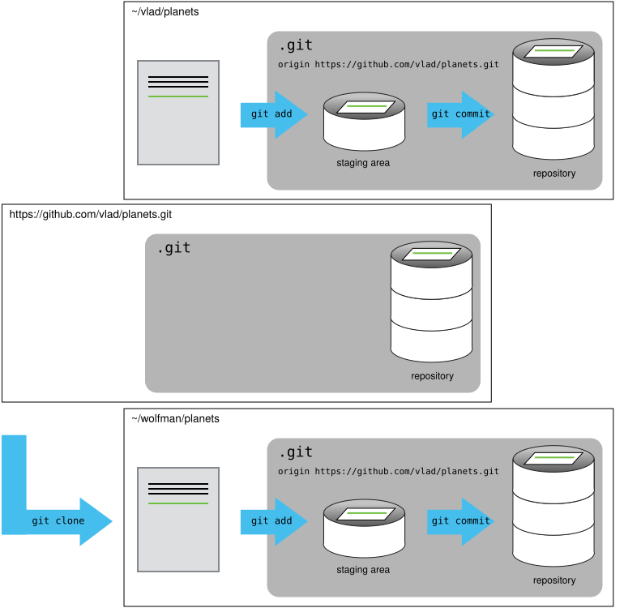

# Sharing a Repository with Others



- Clone a remote repository.
- Collaborate pushing to a common repository.



For the next step, get into pairs.  One person will be the "Owner" and the other
will be the "Collaborator". The goal is that the Collaborator add changes into
the Owner's repository. We will switch roles at the end, so both persons will
play Owner and Collaborator.



If you're working through this lesson on your own, you can carry on by opening
a second terminal window.
This window will represent your partner, working on another computer. You
won't need to give anyone access on GitLab, because both 'partners' are you.



The Owner needs to give the Collaborator access. On GitLab, select
**Manage > Members** in the menu on the left, click **Invite members**, and enter
your partner's username. Choose the **Maintainer** role: GitLab *protects* the
`main` branch by default, and only Maintainers can push to it directly, which
is what we will do in this lesson.





GitLab permission levels might be complicated to understand. [This
table](https://docs.gitlab.com/user/permissions/) might come in handy.



Next, the Collaborator needs to download a copy of the Owner's repository to
their machine. This is called "cloning a repo". To clone the Owner's repo into
their `Desktop` folder, the Collaborator enters:

```bash
$ git clone ssh://git@gitlab.cern.ch:7999/vlad/planets.git ~/Desktop/vlad-planets
```

Replace `vlad` with the Owner's username.



The Collaborator can now make a change in their clone of the Owner's repository,
exactly the same way as we've been doing before:

```bash
$ cd ~/Desktop/vlad-planets
$ nano pluto.txt
$ cat pluto.txt
```
```
It is so a planet!
```

```bash
$ git add pluto.txt
$ git commit -m "Add notes about Pluto"
```
```
 1 file changed, 1 insertion(+)
 create mode 100644 pluto.txt
```

Then push the change to the *Owner's repository* on GitLab:

```bash
$ git push origin main
```
```
Enumerating objects: 4, done.
Counting objects: 100% (4/4), done.
Delta compression using up to 4 threads
Compressing objects: 100% (2/2), done.
Writing objects: 100% (3/3), 306 bytes | 306.00 KiB/s, done.
Total 3 (delta 0), reused 0 (delta 0), pack-reused 0
To ssh://gitlab.cern.ch:7999/vlad/planets.git
   9272da5..29aba7c  main -> main
```

Note that we didn't have to create a remote called `origin`: Git uses this name
by default when we clone a repository.  (This is why `origin` was a sensible
choice earlier when we were setting up remotes by hand.)

Take a look to the Owner's repository on its GitLab website now (maybe you need
to refresh your browser.) You should be able to see the new commit made by the
Collaborator.

To download the Collaborator's changes from GitLab, the Owner now enters:

```bash
$ git pull origin main
```
```
remote: Enumerating objects: 4, done.
remote: Counting objects: 100% (4/4), done.
remote: Compressing objects: 100% (2/2), done.
remote: Total 3 (delta 0), reused 0 (delta 0), pack-reused 0
Unpacking objects: 100% (3/3), 306 bytes | 306.00 KiB/s, done.
From ssh://gitlab.cern.ch:7999/vlad/planets
 * branch            main       -> FETCH_HEAD
   9272da5..29aba7c  main       -> origin/main
Updating 9272da5..29aba7c
Fast-forward
 pluto.txt | 1 +
 1 file changed, 1 insertion(+)
 create mode 100644 pluto.txt
```

Now the three repositories (Owner's local, Collaborator's local, and Owner's on
GitLab) are back in sync.



In practice, it is good to be sure that you have an updated version of the
repository you are collaborating on, so you should `git pull` before making
our changes. The basic collaborative workflow would be:

* update your local repo with `git pull origin main`,
* make your changes and stage them with `git add`,
* commit your changes with `git commit -m`, and
* upload the changes to GitLab with `git push origin main`

It is better to make many commits with smaller changes rather than
of one commit with massive changes: small commits are easier to
read and review.





Switch roles and repeat the whole process.





The Owner push commits to the repository without giving any information
to the Collaborator. How can the Collaborator find out what has changed with
command line? And on GitLab?



On the command line, the Collaborator can use `git fetch origin`
to download the remote changes into the local repository, but without merging
them into their own work. Then `git log main..origin/main` lists the new
commits, and `git diff main origin/main` shows the changes themselves.

On GitLab, the Collaborator can open the project's list of commits (in the
**Code** menu on the left, select **Commits**) and click on any commit to see
its changes. To see everything that differs between two points in history, the
**Code > Compare revisions** page lets you pick two commits or branches and
shows all the commits and changes between them.







The Collaborator has some questions about one line change made by the Owner and
has some suggestions to propose.

With GitLab, it is possible to comment on the changes made in a commit: open
the commit, and hover over the line you want to comment on; a comment icon
appears next to it that opens a comment window.

The Collaborator posts their comments and suggestions using the GitLab interface.





Some backup software can keep a history of the versions of your files, and
also allows you to recover specific versions. How is this functionality different from version control?
What are some of the benefits of using version control, Git and GitLab?



There is no single right answer, but some of the main differences are:

* Backups save versions *automatically*, at fixed times. With version control,
  *you* decide when a version is worth recording, and each commit comes with a
  message explaining what changed and why.
* Version control records *who* made each change, and lets several people work
  on the same files in parallel and merge their work, rather than overwriting
  each other's copies.
* You can compare any two versions, work on branches, and undo one specific
  change without losing the work done since.
* With Git, every clone contains the complete history, and a platform such as
  GitLab adds a place to share it, review each other's changes and discuss
  them.

Version control does not replace backups, though: it is best at tracking text
files such as code and documents, and is not meant for large data files.







- `git clone` copies a remote repository to create a local repository with a remote called `origin` automatically set up.



 [CC BY 4.0](https://creativecommons.org/licenses/by/4.0/legalcode) - Based on [git-novice](https://github.com/swcarpentry/git-novice) © 2016–2017 Software Carpentry Foundation 

