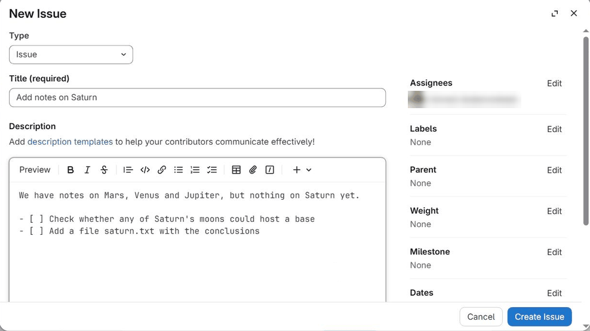

# Tracking Work with Issues



- Explain what issues are and why they are useful.
- Open an issue and write a good description.
- Refer to issues from commits and merge requests, and close them automatically.



So far we have used GitLab to store our repository and share it with others.
Most hosting platforms, including GitLab and GitHub, also help us keep track of
the work *around* the code: the bugs that need fixing, the features we would
like to add, the questions we want to discuss with our collaborators. They do
this with **issues**.

An issue is a page in your project where one topic is described and
discussed. Each issue has:

* a **title** and a **description**, which explain what the issue is about;
* a **number**, such as `#3`, which identifies it within the project;
* a **discussion** thread, where anyone with access can comment;
* a **state**: *open* while there is still something to do, *closed* once it
  has been dealt with.

Issues can be used for anything that needs doing or deciding: reporting a
bug, suggesting an improvement, asking a question, or simply keeping a to-do
list for your own analysis. Unlike a message or an email, an issue stays in the
project, next to the code, where everyone involved can find it later, together
with the discussion that led to a decision.



Like [pull and merge requests](11-pullrequests.md), issues are provided by the
hosting platform, not by Git itself. They are not part of your repository's
history, and they are not copied when you clone it.



## Opening an issue

Let's open an issue in our `planets` repository on
[CERN GitLab](08-gitlab.md). Dracula wants to remember to write some notes on
Saturn, so he opens the project's page and, in the menu on the left, selects
**Plan > Issues** and then **New issue**. (In newer versions of GitLab, issues
are part of **Plan > Work items**, and the button is called **New item**.)

He gives the issue a short title, and a description with more details:

* **Title:** Add notes on Saturn
* **Description:**

```
We have notes on Mars, Venus and Jupiter, but nothing on Saturn yet.

- [ ] Check whether any of Saturn's moons could host a base
- [ ] Add a file saturn.txt with the conclusions
```

The description is written in **Markdown**, so it can contain lists, links and
code blocks. The lines starting with `- [ ]` become a *task list* with
checkboxes that can be ticked off as the work progresses.



Markdown is a simple way of formatting plain text: you write ordinary text with
a few special characters, and the website displays it nicely formatted. It is
used almost everywhere on GitLab and GitHub, in issues, merge requests and
comments, and in `README.md` files, which are shown on the front page of a
repository. The most common elements are (what you write → what you get):

* `**bold**` and `*italic*` → **bold** and *italic*
* `# Heading` → a heading (`##` for a smaller one)
* `- item` → a bullet point in a list
* `` `code` `` → `code`, in a fixed-width font
* `[text](https://example.org)` → a link called "text"

A block of code goes between two lines of three backticks (```` ``` ````).
You can learn the basics in ten minutes with the
[CommonMark tutorial](https://commonmark.org/help/), and both
[GitLab](https://docs.gitlab.com/user/markdown/) and
[GitHub](https://docs.github.com/en/get-started/writing-on-github/getting-started-with-writing-and-formatting-on-github/basic-writing-and-formatting-syntax)
document the extra features they support, such as task lists and tables.



Before creating the issue, he can also use the fields on the right-hand side:

* **Assignee**: who is going to work on it. Dracula assigns the issue to himself.
* **Labels**: short tags such as `bug`, `documentation` or `question`, which
  help to sort issues. Each project defines its own labels.
* **Milestone** and **Due date**: for planning when things should be done.



Once he clicks **Create issue**, the issue gets its number (here `#1`, as it is
the first issue of the project) and appears in the list of open issues.



A good issue saves everybody time, including your future self:

* **Search first**: someone may already have reported the same problem.
* **Use a specific title**: "Plot script crashes when the input file is empty"
  is much more useful than "Bug" or "Help".
* **One topic per issue**: separate problems are easier to discuss, assign and
  close separately.
* **For bugs, say how to reproduce them**: what you did (ideally a small
  example), what you expected to happen, what happened instead (including the
  full error message), and which versions of the software you used.



## Referring to issues

GitLab turns references to issues into links automatically. Writing `#1` in a
comment, in the description of another issue, in a merge request or in a commit
message creates a link to issue number 1, and GitLab shows a note on issue `#1`
that it has been mentioned. In the same way, `@username` mentions a person, who
is then notified, and in GitLab `!2` refers to merge request number 2.

This makes it easy to connect the code to the discussion that motivated it.
For example, Dracula mentions the issue in the commit that adds his notes:

```bash
$ git add saturn.txt
$ git commit -m "Add notes on Saturn (#1)"
```

## Closing issues automatically

Even better, GitLab can close an issue for us. If a commit message contains a
phrase such as `Closes #1`, `Fixes #1` or `Resolves #1`, the issue is closed
automatically as soon as that commit reaches the project's default branch
(`main`):

```bash
$ git commit -m "Add conclusions on Saturn's moons" -m "Closes #1"
$ git push origin main
```

(The second `-m` adds a second paragraph to the commit message; the closing
phrase can be anywhere in the message.)

The same works in the description of a merge request: writing `Closes #1` there
closes the issue when the merge request is merged. This is the usual way issues
are closed in projects that use merge requests, and it is what the next lesson
builds on.



On the page of an issue, GitLab offers a **Create merge request** button. It
creates a new branch named after the issue (for example
`1-add-notes-on-saturn`) together with a merge request that will close the
issue when merged. You can then fetch that branch, switch to it and start
working:

```bash
$ git fetch origin
$ git switch 1-add-notes-on-saturn
```

This "issue, then branch, then merge request" workflow is how many projects
organise their work: the issue describes *what* needs doing and why, the branch
holds the work, and the merge request is where it is reviewed.





Once a project has many issues, GitLab offers several tools to keep them in
order:

* **Labels** can be used to filter the list of issues, for example to show only
  bugs, or only issues about the documentation.
* **Milestones** group the issues that should be done by a certain date or for
  a certain release, and show how many of them are finished.
* **Issue boards** (**Plan > Issue boards**) show issues as cards in columns,
  such as "To do", "Doing" and "Done", that you can drag them between.
* **Templates** let a project provide a pre-filled description, for example a
  bug report form, by adding Markdown files to `.gitlab/issue_templates/` in
  the repository.

See the [GitLab documentation on issues](https://docs.gitlab.com/user/project/issues/)
for more.





Issues on GitHub work in almost the same way: open the **Issues** tab of a
repository and click **New issue**. Labels, assignees, milestones, task lists,
`#number` references and `@username` mentions all work as described above, and
so do closing phrases such as `Closes #1`, in commit messages pushed to the
default branch and in pull request descriptions.

One difference is that on GitHub, issues and pull requests share the same
numbering, and both are referred to with `#`: `#2` may be an issue or a pull
request.





In your `planets` repository on GitLab, open an issue asking for notes on a
planet that you haven't written about yet. Give it a specific title, a
description with a task list of at least two items, and assign it to yourself.
What number does GitLab give it?



If it is the first issue in the project, GitLab numbers it `#1`; otherwise it
gets the next free number. The task list appears with checkboxes, and the issue
is listed under **Plan > Issues** with you as the assignee.







Now do the work: create the file with the notes, and commit it with a message
that closes the issue you just opened. Push the commit to `main`, then look at
the issue on GitLab. What has changed?



Assuming the issue is number 1:

```bash
$ nano saturn.txt
$ git add saturn.txt
$ git commit -m "Add notes on Saturn" -m "Closes #1"
$ git push origin main
```

On GitLab, the issue is now **closed**, and its activity shows that it was
closed by your commit, with a link to it.







Two people report the same problem with the plotting script `make_plot.py`
from the [CI lesson](13-ci.md), a short Python script that draws a histogram
and saves it as `plots/first_plot.pdf`:

1. *"Plot broken!! Please fix ASAP."*
2. *"make_plot.py fails with `FileNotFoundError: plots/first_plot.pdf` when run
   from a new clone. Steps: clone the repository, run `python make_plot.py`.
   Expected: the plot is created. Python 3.12, matplotlib 3.9."*

Which one would you rather receive, and why?



The second one. It says exactly what goes wrong (with the error message), how
to reproduce the problem and what was expected, and which versions were used.
With this information, the maintainer can probably find the cause straight
away: the script saves into a `plots/` directory that does not exist in a new
clone. The first report forces them to ask a series of questions before they
can even start.







- Issues are numbered pages on a hosting platform for tracking bugs, ideas, questions and tasks.
- Good issues have a specific title, cover one topic, and explain how to reproduce a problem.
- `#number` refers to an issue, and `@username` mentions a person.
- Writing `Closes #number` in a commit message or merge request description closes the issue once the change reaches the default branch.



[CC BY 4.0](https://creativecommons.org/licenses/by/4.0/legalcode) - Original content
