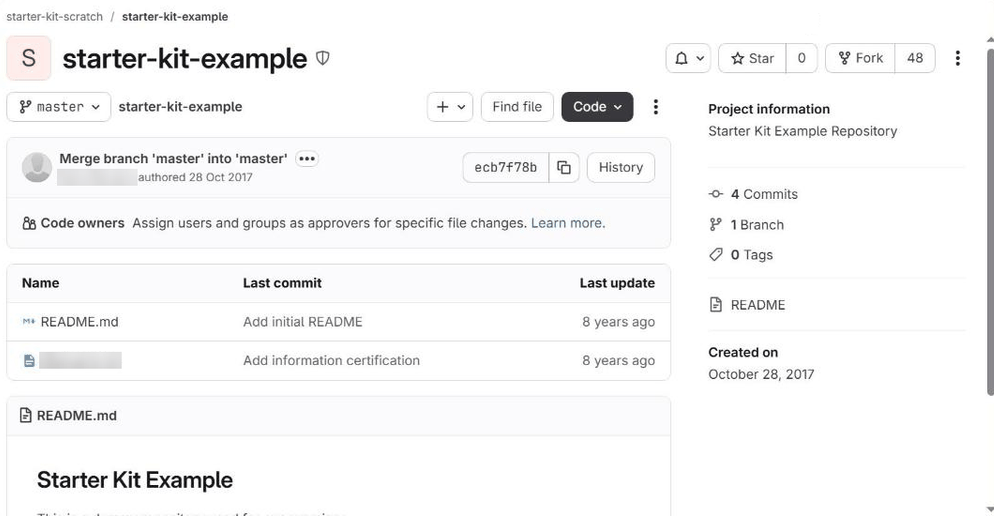
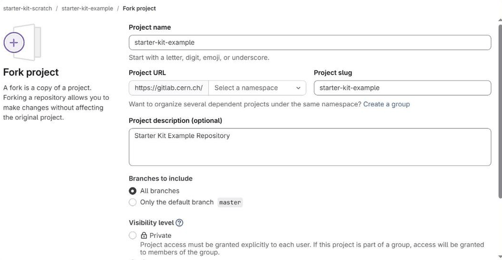
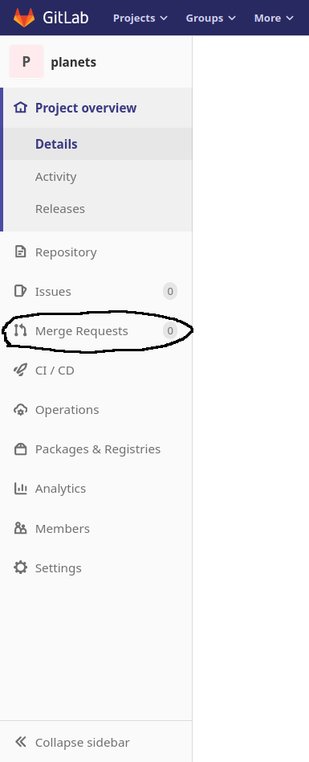
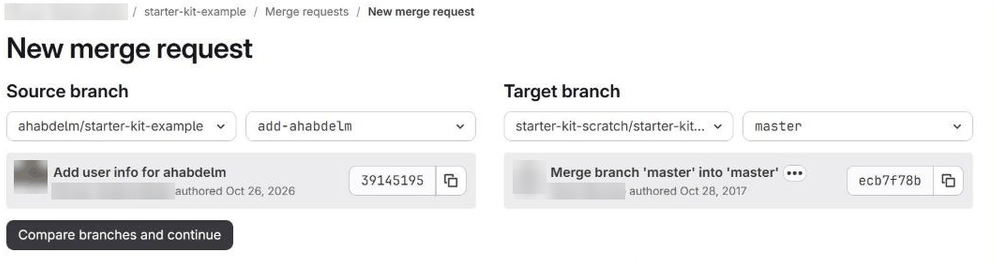
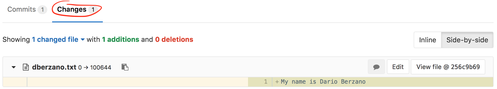
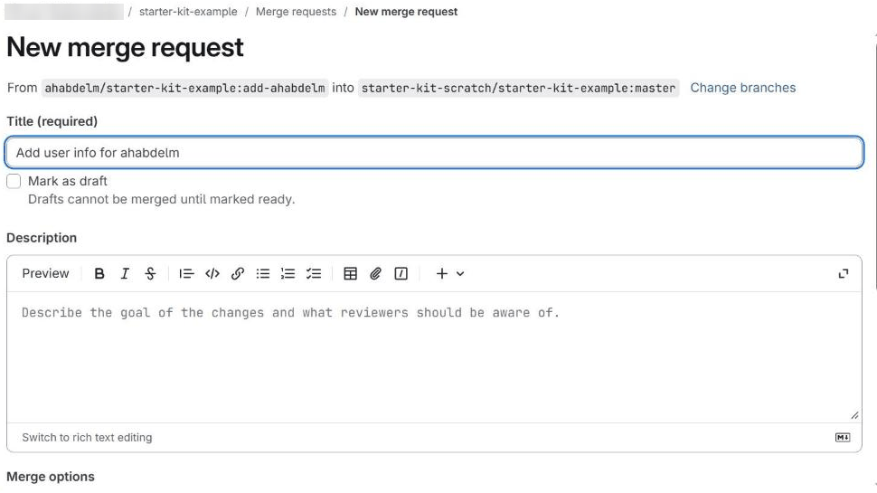
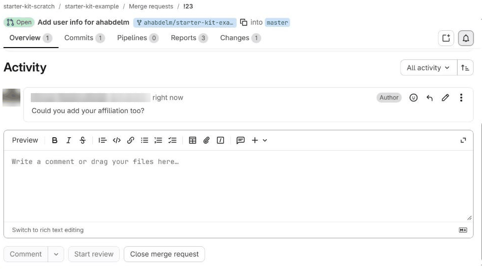
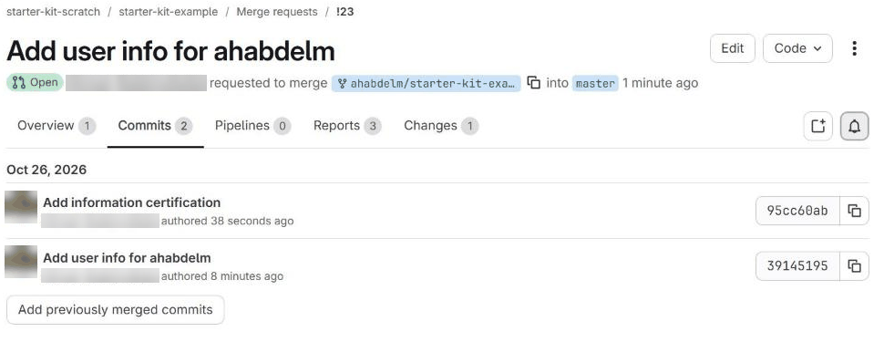
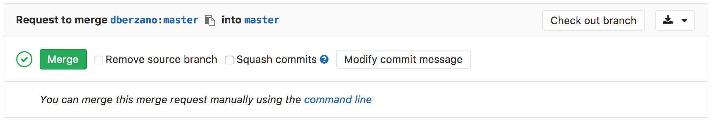

# Collaborating with Pull Requests



* Contribute to Git repositories by proposing changes
* Understand what a Pull (or Merge) Request is
* Develop each proposed change on its own branch
* Use GitLab discussion and review tools to converge on a proposed change



In this lesson we are going to learn how the distributed nature of Git comes in
handy when working on larger projects. We will also see how this approach turns
out to be useful even when working on small projects with only three or four
contributors.

The most naive approach to Git collaboration is what we have [previously
seen](09-share.md):

* We have a **single remote repository**
* This repository has one or more **owners** who decide who can contribute
* **Contributors** can push their changes directly on the repository

[GitHub](https://github.com) popularised a different model, based on **Pull
Requests**, which has since been adopted by other hosting platforms such as
[GitLab](https://about.gitlab.com/), where they are called **Merge Requests**.


## What is a Pull (or Merge) Request

Pull Requests are a way to **propose changes** to a remote repository without
having write permissions to it, and therefore without pushing to it directly.
Note that GitLab (which we are going to use for the following examples) uses the
term "Merge Requests" but the concept stays the same.

The general idea behind Pull Requests is:

* I would like to **contribute** to a repository by adding some code
* I **push** this code *somewhere*, on a branch of its own
* I submit this code for a review to the owners of the original project (this is
  where I open a **Pull Request**)
* Owners will decide whether to **accept or reject** my changes, and a Web-based
  interface allows people to **comment and discuss**



We have seen in a [previous lesson](08-gitlab.md) that the act of
incorporating remote changes into a repository is called "pulling" and it is
achieved by variations of the command `git pull`.

Projects using Pull Requests do not allow people to `git push` code to them.
Instead, what you are doing is **requesting them to pull your code** instead,
therefore the name.





The concept of Pull Requests leverages certain features of Git, but it's not
part of the `git` tool itself: it depends on the hosting platform you use.




## Fork the original project repository

The first step when contributing to a project is to create a **fork**
of the remote repository. Let's see exactly what it means with an example.

Connect to our example repository using a Web browser:

> https://gitlab.cern.ch/starter-kit-scratch/starter-kit-example

and click on the "Fork" button:



GitLab asks where the fork should be created. If you have played already with
GitLab groups you might have several possible destinations; if so, just select
your user:



Your GitLab account will now contain a repository with the same name as the
original, `starter-kit-example`.

At this point, CERN GitLab contains several copies of the same repository:
the original one, and all the forks you and others have created. Those copies
are **remote clones** for now, as they are not on your laptop yet.

The main feature of your fork is that you (and by default you only) have **write
permissions** to it. You cannot directly push to the original repository, but
you can write to your fork.



When you create a fork, you make a snapshot of the original repository at a
given moment in time. From that point on, the fork is independent from both the
original repository and any forks made by other users.




## Clone a remote project and its fork

Now it is time to open your terminal and clone the remote project. [As we have
already seen](08-gitlab.md) we can use the SSH URL for cloning the project:

```bash
$ mkdir test_merge_requests/
$ cd test_merge_requests/
$ git clone ssh://git@gitlab.cern.ch:7999/starter-kit-scratch/starter-kit-example.git
```
```
Cloning into 'starter-kit-example'...
remote: Enumerating objects: 3, done.
remote: Counting objects: 100% (3/3), done.
remote: Compressing objects: 100% (2/2), done.
remote: Total 3 (delta 0), reused 0 (delta 0), pack-reused 0
Receiving objects: 100% (3/3), done.
```

Now putting into practice [what we have already learnt](08-gitlab.md) let's add
our fork as a second remote. It has the same URL as the original repository,
except that `starter-kit-scratch` is replaced with your CERN username, and we
will name the remote after our username too:

```bash
$ cd starter-kit-example/
$ git remote add YOUR_CERN_USERNAME ssh://git@gitlab.cern.ch:7999/YOUR_CERN_USERNAME/starter-kit-example.git
```

Throughout this page, replace `YOUR_CERN_USERNAME` with your own CERN username.
In the example outputs we show, the username is `vlad`, so you will see your
own username wherever `vlad` appears.



* How many remotes do you have now in your repository?
* What are their names?



You can verify what are your remotes by using the `git remote` command:

```bash
$ git remote -v
```
```
vlad	ssh://git@gitlab.cern.ch:7999/vlad/starter-kit-example.git (fetch)
vlad	ssh://git@gitlab.cern.ch:7999/vlad/starter-kit-example.git (push)
origin	ssh://git@gitlab.cern.ch:7999/starter-kit-scratch/starter-kit-example.git (fetch)
origin	ssh://git@gitlab.cern.ch:7999/starter-kit-scratch/starter-kit-example.git (push)
```

You now have **two remotes**: the default one, corresponding to the original
(*upstream*) repository, is called `origin` and was set up when you cloned the
repository. The second one is named after your CERN account (`vlad` in this
example) and you have created it explicitly with `git remote add`.






## Sync your local repository with remote changes

Before starting any new piece of work, make sure your local `main` branch is
up to date with the original (`origin`) repository. If you don't have any
pending local change, you can do:

```bash
$ git switch main
$ git pull
```

Since your `main` branch "tracks" the `main` branch of `origin` (this was set up
automatically when you cloned), `git pull` without any arguments does the right
thing. It is equivalent to `git pull origin main`.



In some cases you might end up with your working directory (and/or branch)
"messed up" and the `git pull` command will not work seamlessly. If you are sure
you are not going to lose anything important, you can simply reset your current
working directory by **ignoring any local modification and destroying it**:

```bash
$ git fetch --all  # make local git aware of what changed remotely
$ git reset --hard origin/main  # lose any local modification
$ git clean -fxd  # get rid of any extra files not under version control
```

You should be **very careful** about using the `git reset` and `git clean`
commands, but they are very useful when your working area got messed up somehow.




## Create a branch for your change

Each Merge Request should contain one self-contained change, and the way to
keep changes apart is to develop each of them on its own
[branch](07-branches.md). Let's create one for our contribution:

```bash
$ git switch -c add-YOUR_CERN_USERNAME
```
```
Switched to a new branch 'add-YOUR_CERN_USERNAME'
```

Working on a branch rather than directly on `main` means that your `main` always
stays identical to the original repository, so it is easy to keep up to date,
and that you can work on several Merge Requests at the same time, one per
branch.


## Implement your new feature

You can now implement your new "feature" by adding a bunch of files with some
random content to your local repository. As an exercise, you can try to add a
file named after your CERN username:

```bash
$ echo "My name is Firstname Lastname" > YOUR_CERN_USERNAME.txt
```

Replace `YOUR_CERN_USERNAME` with your CERN username to avoid [conflicts](12-conflict.md).

You can now commit the changes:

```bash
$ git add --all -v
$ git commit -m 'Add user info for YOUR_CERN_USERNAME'
```



* What did you do with `git add`?
* What did you do with `git commit`?
* Why is the commit message appropriate?
* Where are my changes now?



`git add --all` adds all untracked/modified files to the "staging area", that
is: the area containing the files which will be part of the next commit. The
`-v` (as in *verbose*) switch is useful to spot unwanted additions, as it
prints out every added file.

`git commit` creates a commit, whose message is appropriate as it is shorter than
50 characters and meaningful, in other words it's *concise*.

Your commit is **on your laptop only**, on the branch `add-YOUR_CERN_USERNAME`,
and it is not yet available in your fork or in the original repository.






## Push changes

Without further ado let's push our branch to the original repository:

```bash
$ git push origin add-YOUR_CERN_USERNAME
```

Unfortunately it does not work (your message might actually be slightly
different):

```
remote:
remote: ========================================================================
remote:
remote: ERROR: You are not allowed to push code to this project.
remote:
remote: ========================================================================
remote:
fatal: Could not read from remote repository.

Please make sure you have the correct access rights
and the repository exists.
```

We are not allowed to push to `origin`: all modifications must go through Merge
Requests. This means the only way we have is to push our branch to our own
fork. As it is the first time we push this branch, we use `-u` so that Git
remembers where it goes:

```bash
$ git push -u YOUR_CERN_USERNAME add-YOUR_CERN_USERNAME
```

This time we have had more luck:

```
Enumerating objects: 4, done.
Counting objects: 100% (4/4), done.
Delta compression using up to 8 threads
Compressing objects: 100% (2/2), done.
Writing objects: 100% (3/3), 316 bytes | 316.00 KiB/s, done.
Total 3 (delta 0), reused 0 (delta 0), pack-reused 0
remote:
remote: To create a merge request for add-vlad, visit:
remote:   https://gitlab.cern.ch/vlad/starter-kit-example/-/merge_requests/new?merge_request%5Bsource_branch%5D=add-vlad
remote:
To ssh://gitlab.cern.ch:7999/vlad/starter-kit-example.git
 * [new branch]      add-vlad -> add-vlad
branch 'add-vlad' set up to track 'vlad/add-vlad'.
```

Your changes are now pushed to your fork, on a new branch. Notice that GitLab
even prints a link we can use to open a Merge Request from it. Before doing
that, let's check the status of the remote repositories.



How do you use `git log` to see exactly what the two remote repositories
(`origin`, and your fork) contain?



We use the `--all` option to show all local and remote branches, and
`--decorate` to label them (`-10` limits the history to 10 commits):

```bash
$ git log -10 --oneline --graph --all --decorate
```

This is the output (most recent commits are on top):

```
* 256c9b6 (HEAD -> add-vlad, vlad/add-vlad) Add user info for vlad
* 764051d (origin/main, origin/HEAD, main) Add initial README
```

So you will see that:

* the original repository (`origin/main`) and your local `main` do not contain
  your new commit yet;
* your local branch (`add-vlad`) and the same branch on your fork
  (`vlad/add-vlad`) are in sync and contain the commit you've just
  authored.






## Create a Pull (or Merge) Request

As we have said before, Pull Requests are not part of Git but they depend on
the provider hosting your Git repositories. The quickest way to open one on
GitLab is to follow the link printed by `git push` above. Alternatively, point
your Web browser to your fork:

> https://gitlab.cern.ch/YOUR_CERN_USERNAME/starter-kit-example

Then select **Merge requests** in the menu on the left hand side of the screen
and click **New merge request**:



On the next screen, select your branch `add-YOUR_CERN_USERNAME` as the **Source
branch**, and `starter-kit-scratch/starter-kit-example` with its `main` branch
as the **Target branch**:



then click the **Compare branches and continue** button. The next screen
allows you to review the changes graphically (you need to go at the bottom of
the page and click the **Changes** tab):



If the changes look good to you, assign a title to your Merge Request, and an
extended description. You should follow the same policies you use for writing
commit messages:

* keep the **Title** below 50 characters (well, you don't need to count, but do
  your best to keep it short!),
* add any extra information in the **Description** field.



If your Pull Request has only one commit, the **Title** and **Description**
fields will be automatically filled for you.





When you are ready to proceed, click on the **Create merge request** button.

Now, sit back and relax!



* **Keep them small and focused.** One Merge Request per feature or fix is much
  easier to review than one that changes everything at once.
* **Mark unfinished work as a draft.** Starting the title with `Draft:` (or
  using the "Mark as draft" option) tells reviewers that you are still working
  on it, and prevents it from being merged by accident. It is a good way to ask
  for early feedback.
* **Link related issues.** If your Merge Request solves an
  [issue](10-issues.md), writing `Closes #12` in the description links it to
  issue number 12, and closes the issue automatically when the Merge Request is
  merged.
* **Ask for a review.** You can assign one or more *reviewers*, who will be
  notified and can approve the changes. Reviewers can also *suggest* changes to
  specific lines, which you can accept with a single click.




## Discussing, amending, retiring a Merge Request

Once a Merge Request is opened the repository owners are notified (usually via
email), and they (or even somebody else, depending on the repository's
permissions) can add comments and requests before accepting your changes.

Merge Requests are each given a sequential number. The first ever Merge Request
on the example repository can be found at:

> https://gitlab.cern.ch/starter-kit-scratch/starter-kit-example/-/merge_requests/1

This is how a comment appears, and how you can reply to it:



When you are ready just click on the **Comment** button.

In our example, we have realised that we wanted to add something more to the
Merge Request before proceeding. Doing so is as simple as authoring and pushing
more commits to the same branch.

Let's go back to our local working directory, make sure we are still on our
branch, edit the file `YOUR_CERN_USERNAME.txt` and add a line to it:

```bash
$ git switch add-YOUR_CERN_USERNAME
$ echo "I hereby certify that this information is true." >> YOUR_CERN_USERNAME.txt
```

Now commit:

```bash
$ git add YOUR_CERN_USERNAME.txt
$ git commit -m 'Add information certification'
```
```
[add-vlad d09c134] Add information certification
 1 file changed, 1 insertion(+)
```

...and finally push. Since we used `-u` the first time, a plain `git push` now
knows that this branch goes to our fork:

```bash
$ git push
```
```
Enumerating objects: 5, done.
Counting objects: 100% (5/5), done.
Delta compression using up to 8 threads
Compressing objects: 100% (3/3), done.
Writing objects: 100% (3/3), 359 bytes | 359.00 KiB/s, done.
Total 3 (delta 0), reused 0 (delta 0), pack-reused 0
remote:
remote: View merge request for add-vlad:
remote:   https://gitlab.cern.ch/starter-kit-scratch/starter-kit-example/-/merge_requests/1
remote:
To ssh://gitlab.cern.ch:7999/vlad/starter-kit-example.git
   256c9b6..d09c134  add-vlad -> add-vlad
```

Voilà, it's done: you have just added more commits to your Merge Request! Let's
look on the Web at the commits you have added. Go to the Merge Request page
and click on the **Commits** tab, here is a direct link for the example:

> https://gitlab.cern.ch/starter-kit-scratch/starter-kit-example/-/merge_requests/1/commits





A Merge Request is not a static snapshot of your work at the time you opened
it: it is linked to a *branch* (here, `add-YOUR_CERN_USERNAME` on your fork).
Whatever you push to that branch automatically shows up in the Merge Request,
until the Merge Request is merged or closed. This is another reason to use a
separate branch for each Merge Request.



Adding commits to an existing Merge Request is the very essence of using Merge
Requests: you submit your content for scrutiny, and reviewers will say what
they think before accepting it, giving you the ability to amend things as you
go.

If you or the maintainers of the project are not happy with a Pull Request it
can be retired by clicking on the **Close merge request** button on top
of the page:


## Accepting a Pull Request

When a Merge Request looks good, the repository owners will click on the
**Merge** button:



Your code is then finally included upstream, in the `main` branch of the
original repository. To continue working, bring your local `main` up to date
and delete the branch you no longer need:

```bash
$ git switch main
$ git pull
$ git branch -d add-YOUR_CERN_USERNAME
```

For your next contribution, start again from an up-to-date `main` with a new
branch, as [explained earlier](#sync-your-local-repository-with-remote-changes).



Not really. Your fork is only a place to push your branches to, so that you
can open Merge Requests from them. As long as you create each new branch from
an up-to-date local `main` (which you get with `git pull` from `origin`), your
work starts from the latest version of the original project, and it does not
matter that the `main` branch on your fork is out of date.

If you would like your fork's `main` to be up to date anyway, you can push your
updated local `main` to it with `git push YOUR_CERN_USERNAME main`.




## The social side of coding

Using Pull Requests can seem overly complicated at first, but they are a very
efficient way to truly collaborate on large projects.

* **A Pull Request represents an atomic unit of work.** You can open a Pull
  Request for adding a certain feature, composed by several commits with work in
  progress, minor fixes, major bug fixes. When merged, the feature is finally
  there and complete, available to every collaborator. You reduce the chance of
  having incomplete and/or buggy features in released versions of the code.
* **When writing a Pull Request, you know that your code will be viewed by
  someone.** This makes you more attentive to what other persons will think
  when they see it, making you a better collaborator.
* **Sometimes, good code is like wine (it has to age a little bit to taste
  better).** Pull Requests might stay open for a while before being accepted,
  do not be in a rush: having your code reviewed (sometimes by the most annoying
  and pickiest reviewer!) is a chance for improvement.



Some Pull Requests on large projects can get rather controversial. Bear in mind
that Pull Requests are about facilitating collaboration for a common goal, and -
as in real life - try not to go on a rampage, at least not too quickly!




## Automatic testing

Merge requests can be configured to prevent changes from being merged into the
main branch of a repository if any of the project's builds or tests fail to run
correctly. This is useful to try and ensure that the `main` branch always
contains a "good" version of the project. See the [continuous integration](13-ci.md)
lesson for details on how to set this up with GitLab, along with a list of
services that can be used with other git hosts.




* "Forking" means to create your own editable copy of a remote project on
  the hosting platform
* "Cloning" means to download locally a remote repository and/or its fork
* Each proposed change should be developed on its own branch, pushed to your fork
* "Pull/Merge Requests" allow for discussing code and content before including
  it; pushing more commits to the branch updates the request
* Automatic testing on Pull/Merge Requests ensures better upstream code quality



[CC BY 4.0](https://creativecommons.org/licenses/by/4.0/legalcode) - Original content
