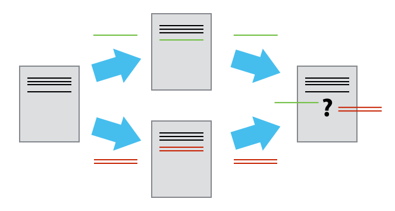

# Conflicts



- Explain what conflicts are and when they can occur.
- Resolve conflicts resulting from merging two branches.
- Resolve conflicts resulting from pulling changes from a remote repository.



As soon as people can work in parallel, it's likely someone's going to step on someone
else's toes.  This will even happen with a single person: if we are working on
a piece of software on both our laptop and a server in the lab, or on two
branches of the same repository, we could make different changes to each copy.
Version control helps us manage these conflicts by giving us tools to
resolve overlapping changes.

## Conflicts between branches

In the lesson on [branching and merging](07-branches.md), Git could combine
our branches automatically because they had changed different files. Let's see
what happens when two branches change the *same line*.

Dracula starts a branch to add another of Jupiter's moons to his notes on
Jupiter:

```bash
$ git switch -c ganymede
$ nano jupiter.txt
$ cat jupiter.txt
```
```
Too much radiation, but Europa and Ganymede might be worth a visit
```

```bash
$ git add jupiter.txt
$ git commit -m "Add Ganymede to the notes on Jupiter"
```

Meanwhile, back on `main`, he edits the same line in a different way:

```bash
$ git switch main
$ nano jupiter.txt
$ cat jupiter.txt
```
```
Far too much radiation, but Europa might be worth a visit
```

```bash
$ git add jupiter.txt
$ git commit -m "Stress the radiation around Jupiter"
```

Now he tries to merge the `ganymede` branch into `main`:

```bash
$ git merge ganymede
```
```
Auto-merging jupiter.txt
CONFLICT (content): Merge conflict in jupiter.txt
Automatic merge failed; fix conflicts and then commit the result.
```

Git cannot know which version of the line is the right one, so it stops
halfway through the merge and asks us to decide. `git status` tells us which
files need our attention:

```bash
$ git status
```
```
On branch main
You have unmerged paths.
  (fix conflicts and run "git commit")
  (use "git merge --abort" to abort the merge)

Unmerged paths:
  (use "git add <file>..." to mark resolution)
	both modified:   jupiter.txt

no changes added to commit (use "git add" and/or "git commit -a")
```

Git has marked the conflict inside the file itself:

```bash
$ cat jupiter.txt
```
```
<<<<<<< HEAD
Far too much radiation, but Europa might be worth a visit
=======
Too much radiation, but Europa and Ganymede might be worth a visit
>>>>>>> ganymede
```

The part between `<<<<<<< HEAD` and `=======` is the version on the branch we
are on (`main`), and the part between `=======` and `>>>>>>> ganymede` is
the version on the branch we are merging in. In a longer file, any lines that
the two branches agree on are left untouched, outside the markers.

To resolve the conflict, we edit the file so that it contains what we actually
want, and remove the markers. We can keep either version, or, as Dracula does
here, write something that combines them:

```bash
$ nano jupiter.txt
$ cat jupiter.txt
```
```
Far too much radiation, but Europa and Ganymede might be worth a visit
```

Then we tell Git that the conflict is resolved by adding the file, and finish
the merge with a commit. Git suggests the message `Merge branch 'ganymede'`,
which we can accept by saving and closing the editor:

```bash
$ git add jupiter.txt
$ git commit
```
```
[main 188ab73] Merge branch 'ganymede'
```

```bash
$ git log --oneline --graph -4
```
```
*   188ab73 Merge branch 'ganymede'
|\
| * 73c1b4c Add Ganymede to the notes on Jupiter
* | b7f8c6e Stress the radiation around Jupiter
|/
* 604e156 Merge branch 'jupiter'
```

The `ganymede` branch has been merged and can now be deleted with
`git branch -d ganymede`.



If a merge produces conflicts that you are not ready to deal with, you can
always go back to where you were before starting it:

```bash
$ git merge --abort
```

Your files and branches are restored exactly as they were before `git merge`,
and you can try again later.





Editing conflict markers in a plain text editor works everywhere, but many
editors can make it easier. [Visual Studio Code](https://code.visualstudio.com/docs/sourcecontrol/overview),
for example, highlights conflicts and offers buttons to "Accept Current Change",
"Accept Incoming Change" or "Accept Both Changes". `git mergetool` launches a
dedicated merge tool, if you have one configured.

Git can also show a little more context in the markers: with

```bash
$ git config --global merge.conflictStyle zdiff3
```

each conflict additionally shows the original version of the lines, before
either side changed them, which often makes it easier to understand what each
side intended.



## Conflicts with a remote

Exactly the same thing can happen when collaborating through a remote
repository. `git pull` is really two steps: `git fetch`, which downloads the
new commits from the remote, followed by `git merge`, which merges them into
our current branch. If someone else has changed the same lines as us, that
merge produces a conflict.

To see this, we need two copies of our `planets` repository, one for each
partner, as in the lesson on [sharing a repository](09-share.md). The file
`mars.txt` currently looks like this in both partners' copies:

```bash
$ cat mars.txt
```
```
Cold and dry, but everything is my favorite color
The two moons may be a problem for Wolfman
But the Mummy will appreciate the lack of humidity
Dust storms can last for months
```

Let's add a line to one partner's copy only:

```bash
$ nano mars.txt
$ cat mars.txt
```
```
Cold and dry, but everything is my favorite color
The two moons may be a problem for Wolfman
But the Mummy will appreciate the lack of humidity
Dust storms can last for months
This line added to Wolfman's copy
```

and then push the change to GitLab:

```bash
$ git add mars.txt
$ git commit -m "Add a line in our home copy"
```
```
[main 5ae9631] Add a line in our home copy
 1 file changed, 1 insertion(+)
```

```bash
$ git push origin main
```
```
Enumerating objects: 5, done.
Counting objects: 100% (5/5), done.
Delta compression using up to 4 threads
Compressing objects: 100% (3/3), done.
Writing objects: 100% (3/3), 352 bytes | 352.00 KiB/s, done.
Total 3 (delta 1), reused 0 (delta 0), pack-reused 0
To ssh://gitlab.cern.ch:7999/vlad/planets.git
   29aba7c..dabb4c8  main -> main
```

Now let's have the other partner
make a different change to their copy
*without* updating from GitLab:

```bash
$ nano mars.txt
$ cat mars.txt
```
```
Cold and dry, but everything is my favorite color
The two moons may be a problem for Wolfman
But the Mummy will appreciate the lack of humidity
Dust storms can last for months
We added a different line in the other copy
```

We can commit the change locally:

```bash
$ git add mars.txt
$ git commit -m "Add a line in my copy"
```
```
[main 07ebc69] Add a line in my copy
 1 file changed, 1 insertion(+)
```

but Git won't let us push it to GitLab:

```bash
$ git push origin main
```
```
To ssh://gitlab.cern.ch:7999/vlad/planets.git
 ! [rejected]        main -> main (fetch first)
error: failed to push some refs to 'ssh://gitlab.cern.ch:7999/vlad/planets.git'
hint: Updates were rejected because the remote contains work that you do not
hint: have locally. This is usually caused by another repository pushing to
hint: the same ref. If you want to integrate the remote changes, use
hint: 'git pull' before pushing again.
hint: See the 'Note about fast-forwards' in 'git push --help' for details.
```



Git detects that the changes made in one copy overlap with those made in the other
and stops us from trampling on our previous work.
What we have to do is pull the changes from GitLab,
merge them into the copy we're currently working in,
and then push that.
Let's start by pulling:

```bash
$ git pull origin main
```
```
remote: Enumerating objects: 5, done.
remote: Counting objects: 100% (5/5), done.
remote: Compressing objects: 100% (2/2), done.
remote: Total 3 (delta 1), reused 0 (delta 0), pack-reused 0
Unpacking objects: 100% (3/3), 352 bytes | 352.00 KiB/s, done.
From ssh://gitlab.cern.ch:7999/vlad/planets
 * branch            main       -> FETCH_HEAD
   29aba7c..dabb4c8  main       -> origin/main
Auto-merging mars.txt
CONFLICT (content): Merge conflict in mars.txt
Automatic merge failed; fix conflicts and then commit the result.
```

`git pull` tells us there's a conflict,
and marks that conflict in the affected file:

```bash
$ cat mars.txt
```
```
Cold and dry, but everything is my favorite color
The two moons may be a problem for Wolfman
But the Mummy will appreciate the lack of humidity
Dust storms can last for months
<<<<<<< HEAD
We added a different line in the other copy
=======
This line added to Wolfman's copy
>>>>>>> dabb4c8c450e8475aee9b14b4383acc99f42af1d
```

Our change—the one in `HEAD`—is preceded by `<<<<<<<`.
Git has then inserted `=======` as a separator between the conflicting changes
and marked the end of the content downloaded from GitLab with `>>>>>>>`.
(The string of letters and digits after that marker
identifies the commit we've just downloaded.)

It is now up to us to edit this file to remove these markers
and reconcile the changes.
We can do anything we want: keep the change made in the local repository, keep
the change made in the remote repository, write something new to replace both,
or get rid of the change entirely.
Let's replace both so that the file looks like this:

```bash
$ cat mars.txt
```
```
Cold and dry, but everything is my favorite color
The two moons may be a problem for Wolfman
But the Mummy will appreciate the lack of humidity
Dust storms can last for months
We removed the conflict on this line
```

To finish merging,
we add `mars.txt` to the changes being made by the merge
and then commit:

```bash
$ git add mars.txt
$ git status
```
```
On branch main
Your branch and 'origin/main' have diverged,
and have 1 and 1 different commits each, respectively.
  (use "git pull" if you want to integrate the remote branch with yours)

All conflicts fixed but you are still merging.
  (use "git commit" to conclude merge)

Changes to be committed:
	modified:   mars.txt

```

```bash
$ git commit -m "Merge changes from GitLab"
```
```
[main 2abf2b1] Merge changes from GitLab
```

Now we can push our changes to GitLab:

```bash
$ git push origin main
```
```
Enumerating objects: 10, done.
Counting objects: 100% (10/10), done.
Delta compression using up to 4 threads
Compressing objects: 100% (6/6), done.
Writing objects: 100% (6/6), 697 bytes | 697.00 KiB/s, done.
Total 6 (delta 2), reused 0 (delta 0), pack-reused 0
To ssh://gitlab.cern.ch:7999/vlad/planets.git
   dabb4c8..2abf2b1  main -> main
```

Git keeps track of what we've merged with what,
so we don't have to fix things by hand again
when the collaborator who made the first change pulls again:

```bash
$ git pull origin main
```
```
remote: Enumerating objects: 10, done.
remote: Counting objects: 100% (10/10), done.
remote: Compressing objects: 100% (4/4), done.
remote: Total 6 (delta 2), reused 0 (delta 0), pack-reused 0
Unpacking objects: 100% (6/6), 697 bytes | 697.00 KiB/s, done.
From ssh://gitlab.cern.ch:7999/vlad/planets
 * branch            main       -> FETCH_HEAD
   dabb4c8..2abf2b1  main       -> origin/main
Updating dabb4c8..2abf2b1
Fast-forward
 mars.txt | 2 +-
 1 file changed, 1 insertion(+), 1 deletion(-)
```

We get the merged file:

```bash
$ cat mars.txt
```
```
Cold and dry, but everything is my favorite color
The two moons may be a problem for Wolfman
But the Mummy will appreciate the lack of humidity
Dust storms can last for months
We removed the conflict on this line
```

We don't need to merge again because Git knows someone has already done that.

Git's ability to resolve conflicts is very useful, but conflict resolution
costs time and effort, and can introduce errors if conflicts are not resolved
correctly. If you find yourself resolving a lot of conflicts in a project,
consider these technical approaches to reducing them:

- Pull from upstream more frequently, especially before starting new work
- Use [branches](07-branches.md) to keep separate pieces of work apart, merging
  them into `main` when complete
- Make smaller more atomic commits
- Where logically appropriate, break large files into smaller ones so that it is
  less likely that two authors will alter the same file simultaneously

Conflicts can also be minimised with project management strategies:

- Clarify who is responsible for what areas with your collaborators
- Discuss what order tasks should be carried out in with your collaborators so
  that tasks expected to change the same lines won't be worked on simultaneously
- If the conflicts are stylistic churn (e.g. tabs vs. spaces), establish a
  project convention and use automatic code formatters to enforce it (e.g.
  `ruff format` or `black` for Python, `clang-format` for C++), for example
  by running them automatically with [pre-commit](https://pre-commit.com/)




Clone the repository created by your instructor.
Add a new file to it,
and modify an existing file (your instructor will tell you which one).
When asked by your instructor,
pull their changes from the repository to create a conflict,
then resolve it.

If you are working through this lesson on your own, you can play both roles:
clone your `planets` repository a second time into another directory, make
different changes to the same line of a file in each copy, commit them, push
from one copy and then pull in the other.






What does Git do
when there is a conflict in an image or some other non-textual file
that is stored in version control?



Let's try it. Suppose Dracula takes a picture of Martian surface and
calls it `mars.jpg`.

If you do not have an image file of Mars available, you can create
a dummy binary file like this:

```bash
$ head --bytes 1024 /dev/urandom > mars.jpg
$ ls -lh mars.jpg
```
```
-rw-r--r-- 1 vlad 57095 1.0K Mar  8 20:24 mars.jpg
```

`ls` shows us that this created a 1-kilobyte file. It is full of
random bytes read from the special file, `/dev/urandom`.

Now, suppose Dracula adds `mars.jpg` to his repository:

```bash
$ git add mars.jpg
$ git commit -m "Add picture of Martian surface"
```
```
[main 8e4115c] Add picture of Martian surface
 1 file changed, 0 insertions(+), 0 deletions(-)
 create mode 100644 mars.jpg
```

Suppose that Wolfman has added a similar picture in the meantime.
His is a picture of the Martian sky, but it is *also* called `mars.jpg`.
When Dracula tries to push, he gets a familiar message:

```bash
$ git push origin main
```
```
To ssh://gitlab.cern.ch:7999/vlad/planets.git
 ! [rejected]        main -> main (fetch first)
error: failed to push some refs to 'ssh://gitlab.cern.ch:7999/vlad/planets.git'
hint: Updates were rejected because the remote contains work that you do not
hint: have locally. This is usually caused by another repository pushing to
hint: the same ref. If you want to integrate the remote changes, use
hint: 'git pull' before pushing again.
hint: See the 'Note about fast-forwards' in 'git push --help' for details.
```

We've learned that we must pull first and resolve any conflicts. When there is
a conflict on an image or other binary file, Git prints a message like this:

```bash
$ git pull origin main
```
```
remote: Enumerating objects: 4, done.
remote: Counting objects: 100% (4/4), done.
remote: Compressing objects: 100% (3/3), done.
remote: Total 3 (delta 0), reused 0 (delta 0), pack-reused 0
Unpacking objects: 100% (3/3), 1.26 KiB | 1.26 MiB/s, done.
From ssh://gitlab.cern.ch:7999/vlad/planets
 * branch            main       -> FETCH_HEAD
   6a67967..439dc8c  main       -> origin/main
warning: Cannot merge binary files: mars.jpg (HEAD vs. 439dc8c08869c342438f6dc4a2b615b05b93c76e)
Auto-merging mars.jpg
CONFLICT (add/add): Merge conflict in mars.jpg
Automatic merge failed; fix conflicts and then commit the result.
```

The conflict message here is mostly the same as it was for `mars.txt`, but
there is one key additional line:

```
warning: Cannot merge binary files: mars.jpg (HEAD vs. 439dc8c08869c342438f6dc4a2b615b05b93c76e)
```

Git cannot automatically insert conflict markers into an image as it does
for text files. So, instead of editing the image file, we must choose the
version we want to keep, and then add and commit it.

`git restore` can pick one side of a conflict for us: `--ours` is the version
on our current branch (`HEAD`, Dracula's picture of the surface), and
`--theirs` is the version we are merging in (Wolfman's picture of the sky).
If we want to use our version:

```bash
$ git restore --ours mars.jpg
$ git add mars.jpg
$ git commit -m "Use image of surface instead of sky"
```
```
[main 21032c3] Use image of surface instead of sky
```

If instead we want to use Wolfman's version, we use `--theirs`:

```bash
$ git restore --theirs mars.jpg
$ git add mars.jpg
$ git commit -m "Use image of sky instead of surface"
```
```
[main da21b34] Use image of sky instead of surface
```

We can also keep *both* images. The catch is that we cannot keep them
under the same name. But we can restore each version in turn and *rename* it:

```bash
$ git restore --ours mars.jpg
$ mv mars.jpg mars-surface.jpg
$ git restore --theirs mars.jpg
$ mv mars.jpg mars-sky.jpg
```

Then, remove the conflicting `mars.jpg` and add the two new files:

```bash
$ git rm mars.jpg
$ git add mars-surface.jpg mars-sky.jpg
$ git commit -m "Use two images: surface and sky"
```
```
[main 94ae08c] Use two images: surface and sky
```

Now both images of Mars are checked into the repository, and `mars.jpg`
no longer exists.








You sit down at your computer to work on a shared project that is tracked in a
remote Git repository. During your work session, you take the following
actions, but not in this order:

- *Make changes* by appending the number `100` to a text file `numbers.txt`
- *Update remote* repository to match the local repository
- *Celebrate* your success
- *Update local* repository to match the remote repository
- *Stage changes* to be committed
- *Commit changes* to the local repository

In what order should you perform these actions to minimise the chances of
conflicts? Put the actions in the right order in the *Action* column of the
table below. When you have the order right, see if you can also write the
corresponding commands in the *Command* column. A few steps are filled in to
get you started.

```eval_rst
.. list-table::
   :header-rows: 1

   * - Order
     - Action
     - Command
   * - 1
     - ?
     - ?
   * - 2
     - ?
     - ``echo 100 >> numbers.txt``
   * - 3
     - ?
     - ?
   * - 4
     - ?
     - ?
   * - 5
     - ?
     - ?
   * - 6
     - Celebrate!
     - ``AFK``
```



```eval_rst
.. list-table::
   :header-rows: 1

   * - Order
     - Action
     - Command
   * - 1
     - Update local
     - ``git pull origin main``
   * - 2
     - Make changes
     - ``echo 100 >> numbers.txt``
   * - 3
     - Stage changes
     - ``git add numbers.txt``
   * - 4
     - Commit changes
     - ``git commit -m "Add 100 to numbers.txt"``
   * - 5
     - Update remote
     - ``git push origin main``
   * - 6
     - Celebrate!
     - ``AFK``
```








- Conflicts occur when two branches, or two people, change the same lines of a file in different ways.
- The version control system does not allow people to overwrite each other's changes blindly, but highlights conflicts so that they can be resolved.
- To resolve a conflict, edit the file to remove the markers, then `git add` it and `git commit` to finish the merge.
- `git merge --abort` goes back to the state before the merge.
- `git pull` is a `git fetch` followed by a `git merge`, so conflicts with a remote are resolved in the same way.



[CC BY 4.0](https://creativecommons.org/licenses/by/4.0/legalcode) - Based on [git-novice](https://github.com/swcarpentry/git-novice) © 2016–2017 Software Carpentry Foundation
