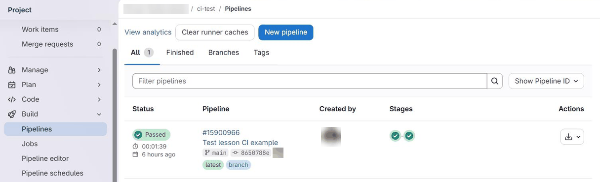
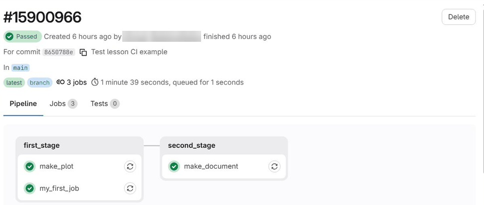
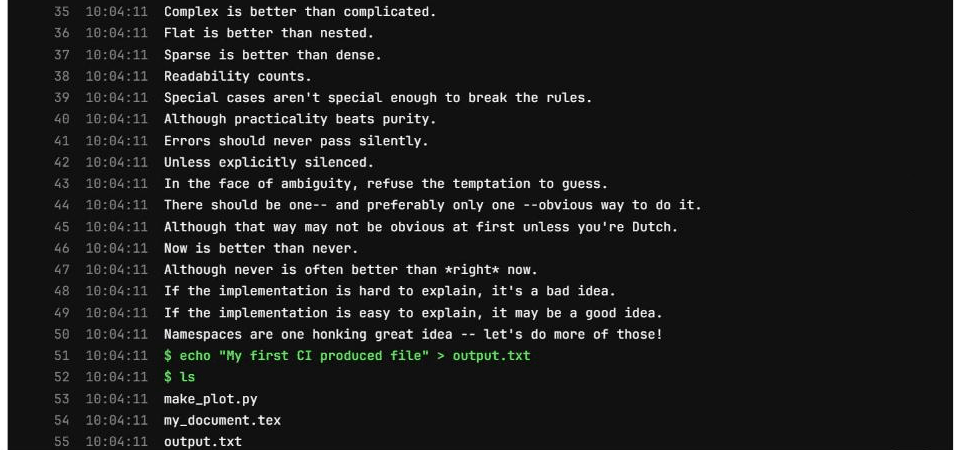
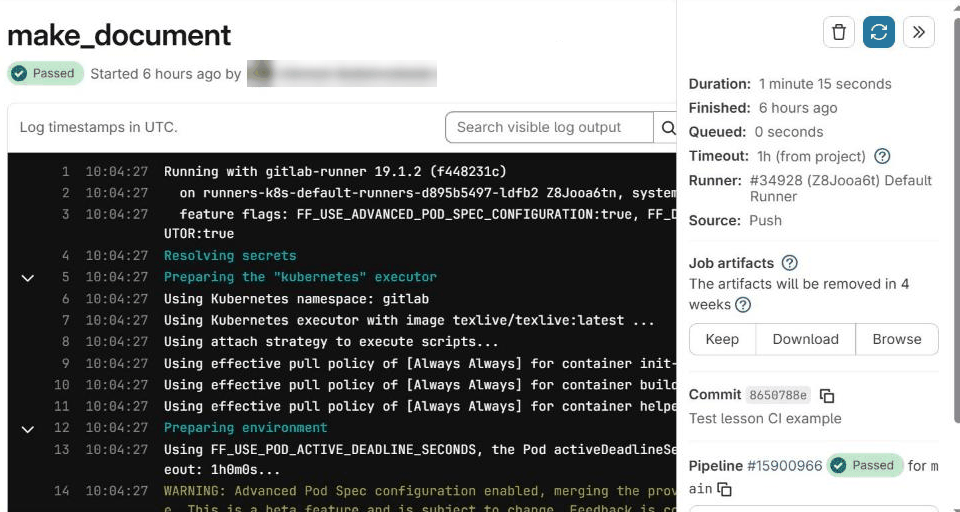

# Continuous Integration



- Understand what continuous integration is and why it is useful.
- Be able to set up a simple CI pipeline.
- Store an artefact from a CI job.



Continuous integration (or CI) is a popular development practice where one or
more tasks are run automatically, often each time a commit is pushed to a remote
repository. These tasks typically involve running tests for software packages or
deploying changes. In fact, this very website is built and published by CI jobs
every time a change is merged. In addition to the conventional uses, some
physicists use CI to automatically build LaTeX documents or parts of their
analyses.

Some examples of CI services are
[GitHub Actions](https://docs.github.com/en/actions),
[GitLab CI](https://docs.gitlab.com/ci/) and [CircleCI](https://circleci.com/).
In this lesson we will use GitLab CI, which is integrated into CERN's GitLab
instance and allows continuous integration to be used for free for both private
and public repositories, without the need to sign up to additional services.

In order to start using GitLab CI you just need to commit a file in the main
directory of your repository called `.gitlab-ci.yml`. This file is used to
specify a *pipeline*, which can be built up of any number of *jobs*, each with
its own environment. A minimal example of this file is:

```yaml
my_first_job:
    image: gitlab-registry.cern.ch/linuxsupport/alma9-base
    script:
        - python3 -c 'import this'
        - echo "My first CI produced file" > output.txt
        - ls
```

This creates a single job named `my_first_job`. The `image:` key defines a
[Docker image](https://www.freecodecamp.org/news/a-beginner-friendly-introduction-to-containers-vms-and-docker-79a9e3e119b/)
which provides the environment the job runs in, i.e. the operating system and
the software that is installed. In this case we use an
[official CERN AlmaLinux 9 image](https://gitlab.cern.ch/linuxsupport/alma9-base/container_registry).
More images are listed in the [documentation pages](https://linux.web.cern.ch/dockerimages/) for Linux at CERN.
The `script:` key then defines one or more commands which are executed
one after the other. If any of the commands returns a non-zero exit code, the
execution stops and the job is marked as failed. (Note that we call `python3`
rather than `python`: the AlmaLinux 9 image only provides the former, so
`python` would fail with "command not found". Always check which commands exist
in the image you choose.)

Once this file is committed and pushed, go to the GitLab web interface for your
`planets` repository and select **Build > Pipelines** in the menu on the left.
(The screenshots in this section were taken with the complete pipeline that we
build later in this lesson, so they show more jobs and files than your first
pipeline will.)



Here you can see any recent pipelines. At first our pipeline is marked as
pending while it waits for a suitable machine, known in GitLab CI as a *runner*,
to be available. CERN provides a collection of shared runners which are
available to all users and these are automatically enabled for all repositories.

Typically a trivial job like this one will take a few minutes to run, which is
almost entirely spent setting up the environment prior to starting the actual
job. Once your job is completed you should be able to see the output of the job
by clicking on the status of the pipeline:



Then click on the name of the job you are interested in, here `my_first_job`.
If you scroll down its log, you should be able to see the output of the three
commands:





If you ever want to check on a job's progress, the log can also be examined
while the job is running, in the same way.





Pipelines also run for the branches of [merge requests](11-pullrequests.md), and
GitLab shows their result directly on the merge request page. Reviewers can then
see at a glance whether the proposed changes still pass all the tests before
they merge them.



Sometimes it is useful to be able to store files that are produced during a
pipeline, such as the `output.txt` file we have produced. By default, everything
a job creates is deleted when the job ends. However, output files and
directories can be kept by declaring them as *artefacts* (GitLab uses the
American spelling, `artifacts`, in its configuration and interface). Artefacts
are normally kept for 30 days (this can be changed with the `expire_in`
keyword), and later jobs in the pipeline can use them too.

Our first pipeline can be extended to produce a plot using Python and then
compile a LaTeX document using this plot, by modifying `.gitlab-ci.yml` to contain:

```yaml
stages:
    - first_stage
    - second_stage

my_first_job:
    stage: first_stage
    image: gitlab-registry.cern.ch/linuxsupport/alma9-base
    script:
        - python3 -c 'import this'
        - echo "My first CI produced file" > output.txt
        - ls
    artifacts:
        paths:
            - "*.txt"

make_plot:
    stage: first_stage
    image: python:3.12-slim
    before_script:
        - pip install matplotlib numpy
        # Matplotlib should use a backend that is suitable for CI
        - 'echo "backend : Agg" > matplotlibrc'
    script:
        - mkdir -p plots/
        - python make_plot.py
    artifacts:
        paths:
            - plots/

make_document:
    stage: second_stage
    image: texlive/texlive:latest
    script:
        - latexmk -pdf my_document.tex
    dependencies:
        - make_plot
    artifacts:
        paths:
            - my_document.pdf
```

Each keyword in the configuration does the following:

```eval_rst
.. list-table::
   :header-rows: 1
   :widths: 1 4

   * - Keyword
     - What it does
   * - ``stages``
     - Specifies the order in which to run each stage. Each job is then assigned to a particular stage using the ``stage`` key. All jobs in a stage can be executed in parallel, while later jobs wait until all jobs in the previous stage have completed successfully.
   * - ``image``
     - Defines a Docker image which provides the environment (i.e. what software is installed) for the job.
   * - ``before_script``
     - One or more commands which are executed before starting the main job. This is typically used for installing software and generally setting up the environment.
   * - ``script``
     - One or more commands to be executed.
   * - ``artifacts``
     - Stores files and directories produced by the job.
   * - ``dependencies``
     - Specifies previous jobs which create artefacts that are required by this job. These are then placed into the job's environment at the same path that they were originally created at.
```

See the [GitLab CI documentation](https://docs.gitlab.com/ci/yaml/) for a
full description of everything that can go in the CI configuration file.

Again commit and push the `.gitlab-ci.yml` file along with
[`make_plot.py`](files/make_plot.py) and [`my_document.tex`](files/my_document.tex)
and wait for the pipeline to complete. You will then be able to download some or
all of the artefacts from the page of each job, like so:





With `stages`, a job only starts once *every* job in the previous stage has
finished. In larger pipelines this can waste time: here, `make_document` has to
wait for `my_first_job` even though it only uses the plot. The `needs` keyword
lets a job start as soon as the specific jobs it needs have finished, and also
downloads their artefacts:

```yaml
make_document:
    stage: second_stage
    image: texlive/texlive:latest
    needs:
        - make_plot
    script:
        - latexmk -pdf my_document.tex
    artifacts:
        paths:
            - my_document.pdf
```

Notice that the `dependencies` keyword is gone: `needs` already downloads the
artefacts of the jobs it lists, so there is no need for both (and GitLab
recommends not combining them in the same job). See the documentation of
[`needs`](https://docs.gitlab.com/ci/yaml/#needs) for details.





On GitHub, CI is provided by GitHub Actions. The ideas are the same (jobs made
of steps, running in a fresh environment, with artefacts passed between them),
but the configuration lives in `.github/workflows/`, for example in
`.github/workflows/ci.yml`, and uses ready-made *actions* for common steps such
as checking out the repository:

```yaml
name: CI
on: [push, pull_request]

jobs:
  make_plot:
    runs-on: ubuntu-latest
    steps:
      - uses: actions/checkout@v7
      - uses: actions/setup-python@v7
        with:
          python-version: "3.12"
      - run: pip install matplotlib numpy
      - run: mkdir -p plots && python make_plot.py
      - uses: actions/upload-artifact@v7
        with:
          name: plots
          path: plots/

  make_document:
    needs: make_plot
    runs-on: ubuntu-latest
    container: texlive/texlive:latest
    steps:
      - uses: actions/checkout@v7
      - uses: actions/download-artifact@v8
        with:
          name: plots
          path: plots/
      - run: latexmk -pdf my_document.tex
      - uses: actions/upload-artifact@v7
        with:
          name: document
          path: my_document.pdf
```

The results appear in the **Actions** tab of the repository. This website
itself is built this way: see its
[workflow file](https://github.com/hsf-training/analysis-essentials/blob/master/.github/workflows/build.yml).





Sometimes it can be difficult to understand errors in the configuration of a
pipeline. Fortunately GitLab has a
[pipeline editor](https://docs.gitlab.com/ci/pipeline_editor/) (in your
project, select **Build > Pipeline editor**) which checks your configuration
as you type and can show how it will be interpreted, without needing to make a
commit.





Some of the shared runners at CERN have special features available such as
CVMFS. Additionally, you can make a private runner if you want to completely
control the runner and add features such as persistent storage between builds.
See the [CERN GitLab documentation](https://gitlab.docs.cern.ch/) (CERN login
required) for more details and examples for common use cases.





- Continuous integration can be used to run commands or scripts every time a
  commit is pushed.
- The `.gitlab-ci.yml` file is used to configure CI on GitLab; each job runs in
  the environment defined by its Docker image.
- Files produced by a job can be kept as artefacts and passed on to later jobs.
- CI results are shown on merge requests, so problems are caught before
  changes are merged.



[CC BY 4.0](https://creativecommons.org/licenses/by/4.0/legalcode) - Original content
